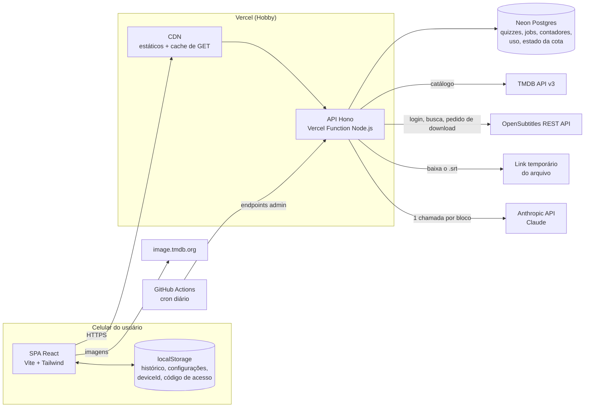
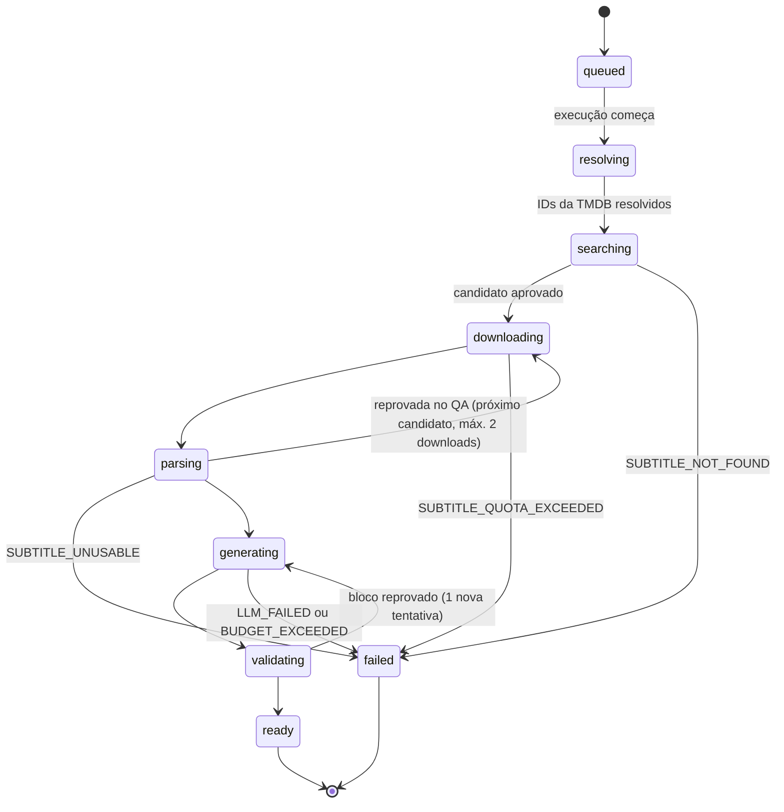

# 3. Arquitetura

## 3.1 Visão em uma página

- **Front-end:** SPA React servida pela CDN da Vercel. Fala só com `/api/*` no mesmo domínio (sem CORS). Imagens vêm direto do CDN da TMDB. Histórico e configurações ficam no `localStorage`.
- **Backend (BFF):** um único app Hono rodando como Vercel Function (Node.js). Faz proxy da TMDB (com cache na CDN), orquestra a geração (OpenSubtitles → parser → LLM → validação) e guarda quizzes, jobs, contadores e uso no Postgres (Neon).
- **Geração:** `POST` cria um job e responde `202` na hora; a mesma invocação continua o trabalho em `waitUntil` (até 300 s no plano Hobby). O front consulta o job a cada 2–4 s. A legenda vive só na memória dessa invocação.
- **Tarefas agendadas:** GitHub Actions chama endpoints de admin uma vez por dia (pré-geração dentro da cota; renovação/limpeza de metadados da TMDB).

## 3.2 Diagrama de componentes



## 3.3 Diagrama de sequência — fluxo principal

```mermaid
sequenceDiagram
  autonumber
  actor U as Usuário
  participant W as SPA
  participant A as API Hono
  participant D as Postgres
  participant T as TMDB
  participant O as OpenSubtitles
  participant L as Claude

  U->>W: Toca no episódio S01E01
  W->>A: GET /api/episodes/{seriesId}/1/1/quiz
  A->>D: busca quiz pronto por episodeKey
  alt quiz já existe
    D-->>A: quiz (JSONB)
    A-->>W: 200 quiz
  else ainda não existe
    A-->>W: 404 QUIZ_NOT_FOUND
    U->>W: Toca "Gerar quiz"
    W->>A: POST /api/episodes/{seriesId}/1/1/quiz + X-Access-Code
    A->>D: confere código, rate limit e orçamento; cria job (único por episódio)
    A-->>W: 202 {jobId}
    Note over A: o restante roda em waitUntil()
    A->>T: episódio en-US + external_ids
    A->>O: GET /subtitles (parent_tmdb_id, season, episode, languages=en)
    O-->>A: candidatos
    A->>A: filtra, valida título, pontua
    A->>O: POST /download {file_id}
    O-->>A: {link, remaining, reset_time_utc}
    A->>O: GET link temporário
    O-->>A: bytes do .srt
    A->>A: decodifica, limpa, junta linhas, segmenta (memória)
    par Bloco 1
      A->>L: system + linhas do bloco 1
    and Bloco 2
      A->>L: system + linhas do bloco 2
    and Bloco n
      A->>L: system + linhas do bloco n
    end
    L-->>A: JSON no schema (por bloco)
    A->>A: valida schema, semântica e evidências; refaz bloco reprovado (1x)
    A->>D: grava quiz; job = ready
    loop a cada 2–4 s enquanto a tela estiver visível
      W->>A: GET /api/jobs/{jobId}
      A-->>W: {status, stage, progress}
    end
    W->>A: GET /api/episodes/{seriesId}/1/1/quiz
    A-->>W: 200 quiz
  end
  W-->>U: Bloco 1 · perguntas do nível escolhido
```

## 3.4 Estados do job



Qualquer estado ativo vira `failed` com `JOB_STALLED` quando o `heartbeat_at` passa de 90 s sem atualização (recuperação preguiçosa na leitura do job; ADR-005).

## 3.5 Stack

| Camada | Escolha | Por quê |
|---|---|---|
| Linguagem | TypeScript `strict` no front, no back e nos scripts | Contratos compartilhados; assistentes de código erram menos com tipos |
| Pacotes | pnpm, um único `package.json` | Sem workspaces para manter |
| Build | Vite | Padrão de mercado para SPA React; rápido |
| UI | React + Tailwind CSS v4 | Obrigatórios; v4 usa plugin do Vite e tema em CSS |
| Rotas | React Router (modo declarativo) | Maduro e simples para ~8 telas |
| Estado do servidor | TanStack Query | Cache, retry e polling com `refetchInterval` (pausa sozinho em segundo plano) |
| Estado local | Zustand + `persist` | Histórico e configurações versionados no `localStorage` |
| Validação | Zod (v4) | DTOs, variáveis de ambiente e schema do quiz; `z.toJSONSchema()` gera o JSON Schema enviado à LLM |
| Backend | Hono | Roteamento e middlewares leves; roda igual em Vercel, Node e Workers |
| Banco | Neon Postgres + Drizzle ORM | SQL tipado, migrações; PGlite nos testes |
| LLM | `@anthropic-ai/sdk` | Saída estruturada, retries e streaming prontos |
| Testes | Vitest, Testing Library, MSW, PGlite, Playwright, axe-core | ADR-012 |
| Qualidade | Biome (lint + format) e `tsc --noEmit` | Uma ferramenta, pouca configuração |
| Runtime | Node.js LTS (22 ou 24) ⚠️ confirmar a versão padrão da Vercel no momento do setup | — |

## 3.6 Orçamento de tempo do job

| Etapa | Timeout por chamada | Retries | Observação |
|---|---|---|---|
| TMDB (episódio en-US + `external_ids`) | 5 s | 2 (429/5xx) | Resultado cacheado no banco |
| Login OpenSubtitles (só se o token expirou) | 10 s | 1 | Token reaproveitado entre jobs |
| Busca de legendas (até 5 estratégias) | 8 s cada, 30 s no total | 2 por chamada (429/5xx) | Busca não consome cota |
| Pedido de download | 10 s | 1 (só 5xx) | Consome cota |
| Baixar o arquivo | 15 s | 1 | Link temporário |
| Decodificar, limpar, segmentar, QA | < 1 s | — | Em memória |
| LLM por bloco | 120 s | 1 regeneração por bloco | Até 4 em paralelo |
| Validação e gravação | < 3 s | 1 | Transação única |
| **Deadline do job** | **240 s** | — | A função tem 300 s no Hobby; sobra margem para gravar a falha |

---

## 3.7 ADRs

### ADR-001 — TypeScript em tudo, um único pacote
- **Status:** aceito.
- **Contexto:** uma pessoa, com assistentes de IA; front e back mudam juntos.
- **Decisão:** TypeScript `strict` em tudo; um `package.json`; pastas de topo `src/` (SPA), `server/` (API), `shared/` (contratos Zod e tipos), `api/` (entrada da função na Vercel), `scripts/` (CLI de admin e avaliação), `tests/` e `docs/`.
- **Alternativas:** monorepo com workspaces (Turborepo/Nx): mais isolamento, mais configuração. JavaScript puro: menos atrito no início, contratos frágeis.
- **Trade-offs:** é preciso impedir que o bundle do front importe `server/` (regra de lint + teste no build). Aliases: `@shared/*`, `@server/*`, `@/*` (front).

### ADR-002 — Front-end
- **Status:** aceito.
- **Decisão:** Vite + React + React Router + TanStack Query + Zustand (`persist`) + Tailwind CSS v4 com dark mode por classe. Componentes próprios e acessíveis; uma biblioteca headless (Radix ou Headless UI) só se surgir diálogo/menu complexo.
- **Alternativas:** Next.js (SSR e Server Components não trazem ganho para uma segunda tela autenticada por código; mais conceitos); TanStack Router (tipagem melhor, menos familiar); Redux (cerimônia).
- **Trade-offs:** sem SEO (irrelevante); primeira carga depende do JS, mitigado por bundle pequeno e divisão por rota.

### ADR-003 — Backend e hospedagem: BFF serverless em Hono na Vercel
- **Status:** aceito.
- **Contexto:** as credenciais da OpenSubtitles e da LLM não podem ir ao navegador; a geração leva 30–150 s; custo próximo de zero; nenhum servidor para administrar.
- **Decisão:** um app Hono (`server/app.ts`) exposto como Vercel Function Node.js em `/api/*`, com a SPA no mesmo projeto e domínio. Plano Hobby (gratuito, uso não comercial, coerente com a TMDB gratuita). Só `api/[[...route]].ts` conhece a Vercel (adaptador `hono/vercel` ⚠️ confirmar a forma recomendada no setup); localmente o mesmo app roda com `@hono/node-server`.

| Critério | **Vercel Functions + Hono (escolhida)** | Cloudflare Workers + D1 | BFF Node contínuo (Fly.io/Railway) | Supabase (Edge Functions + Postgres) |
|---|---|---|---|---|
| Custo inicial | US$ 0 (Hobby, não comercial) | US$ 0 (Free) ou US$ 5/mês (Paid) | ~US$ 2–5/mês ⚠️ | US$ 0; projeto Free pausa após 1 semana ocioso |
| Geração de 30–150 s | ✅ até 300 s + `waitUntil` | ⚠️ Free: 10 ms de CPU por requisição e `waitUntil` só +30 s após desconexão; exigiria Paid + Queues/Workflows | ✅ processo contínuo, sem limite | ⚠️ limites de duração a verificar |
| Runtime | Node completo | workerd (`nodejs_compat`); libs que usam `eval` falham | Node completo | Deno |
| Banco | Neon via integração | D1 (SQLite) nativo | SQLite em volume ou Postgres | Postgres incluso |
| Operação | `git push` | `wrangler deploy` | Docker, volume, backups | baixa |
| Lock-in | baixo (Hono portátil) | médio (bindings) | baixo | médio |
| Quando reconsiderar | — | Se precisar escalar barato | Se o limite de 300 s incomodar | Quando entrar login/sync |

- **Consequências:** limite de 300 s por invocação (deadline do job em 240 s); IPs de saída compartilhados com outros clientes da Vercel, o que obriga a usar login na OpenSubtitles (§4.2.2); cold start de função + Neon só no primeiro acesso (~0,5–1,5 s).
- **Revisitar se:** jobs passarem de 240 s com frequência, o uso virar comercial ou surgir custo na Vercel.

### ADR-004 — Banco: Neon Postgres + Drizzle
- **Status:** aceito.
- **Decisão:** Neon Free (0,5 GB e 100 CU-horas/mês por projeto; suspende após 5 min ocioso). Drizzle ORM com o driver serverless do Neon em produção e PGlite (Postgres em WASM) nos testes. Migrações versionadas com `drizzle-kit`.
- **Volume esperado:** um quiz de sitcom ocupa ~40 KB em JSONB (32 perguntas com explicação EN+PT); 1.000 quizzes ≈ 40–80 MB. Cabe no plano gratuito com folga.

| Opção | Prós | Contras |
|---|---|---|
| **Neon Postgres (escolhida)** | Postgres padrão; JSONB; índices parciais e `ON CONFLICT`; integração com a Vercel; branches para preview | Cold start após ociosidade (~0,5–1 s) |
| Turso (libSQL/SQLite) | Arquivo local em dev, zero setup | Menos recursos de concorrência; ecossistema menor |
| Supabase Postgres | Auth pronto para o pós-MVP | Projeto Free pausa por inatividade; mais produto do que precisamos |
| Cloudflare D1 | Barato | Amarra à Cloudflare (ADR-003) |
| Só KV/Redis | Simples para cache | Péssimo para jobs, relatórios e consultas |

- **Consequências:** o quiz é um documento JSONB (uma leitura por quiz); a regra "um job ativo por episódio" vive no banco (índice único parcial), não no código.

### ADR-005 — Geração assíncrona: job persistido + `waitUntil` + polling
- **Status:** aceito.
- **Decisão:** `POST /api/episodes/…/quiz` valida, cria `generation_jobs` (status `queued`) e responde `202 {jobId}`; em seguida chama `waitUntil(runJob(jobId))` (`@vercel/functions`). O worker atualiza `stage`, `progress` e `heartbeat_at` a cada etapa e a cada bloco. O front usa TanStack Query com `refetchInterval` (2 s nos primeiros 20 s, depois 4 s), que pausa com a aba oculta e retoma ao voltar. Idempotência: índice único parcial em `episode_key` para jobs `queued`/`running`; um segundo `POST` devolve o job existente.
- **Recuperação:** ao ler um job ativo com `heartbeat_at` > 90 s, o backend o marca `failed` (`JOB_STALLED`); o próximo `POST` cria outro. A legenda é baixada de novo nesse caso raro; a cota por episódio (máx. 2 downloads/24 h) limita o prejuízo.

| Opção | Prós | Contras |
|---|---|---|
| **Job + `waitUntil` + polling (escolhida)** | Nenhum serviço extra; sobrevive a tela bloqueada; idempotente | Limite de 300 s; instância que morre deixa o job "travado" até a recuperação |
| SSE/streaming até o navegador | Progresso fluido | Cai com tela bloqueada e rede móvel; reconexão complexa |
| Fila gerenciada (Upstash QStash, Inngest) | Retries e agendamento prontos | Mais um fornecedor e segredo para ~20 jobs/dia |
| Cloudflare Queues/Workflows | Durável, passos com retry | Exige trocar de plataforma |

### ADR-006 — Rate limit, orçamento e código de acesso
- **Status:** aceito.
- **Decisão:** três camadas, todas no Postgres:
  1. **Código de acesso para gerar** (`X-Access-Code`, comparação em tempo constante com `GENERATION_ACCESS_CODE`). Sem ele, o app é só leitura.
  2. **Rate limit por janela fixa** com `INSERT … ON CONFLICT DO UPDATE SET count = count + 1 RETURNING count` na tabela `rate_limit_counters`. Chaves: IP (hash SHA-256 com sal) e `deviceId`.
  3. **Tetos globais:** gerações por dia (`DAILY_GENERATION_LIMIT`, padrão 25) e gasto de LLM por dia (`LLM_DAILY_BUDGET_USD`, padrão 1,00), verificados antes de iniciar o job e antes de cada chamada à LLM.

| Bucket | Limite padrão |
|---|---|
| `gen:ip` | 5/h e 15/dia |
| `gen:device` | 5/h |
| `gen:global` | 25/dia |
| `access-code-fail:ip` | 5/h (bloqueio de 1 h) |
| `read:ip` (catálogo e quiz) | 120/min |
| `upload:ip` | 5/dia |

| Opção | Prós | Contras |
|---|---|---|
| **Contadores no Postgres (escolhida)** | Sem fornecedor extra; atômico; mesmo lugar dos tetos de orçamento | ~5–20 ms por checagem |
| Upstash Redis + `@upstash/ratelimit` | Janela deslizante pronta | Mais um serviço e segredo |
| Firewall da Vercel | Sem código | Regras e limites variam por plano ⚠️; não conhece "orçamento em US$" |
| Só o código de acesso | Trivial | Não protege contra código vazado nem contra bug em loop |

- **Observação:** a cota da OpenSubtitles já limita naturalmente as gerações (cada uma exige um download), mas o teto em US$ é a proteção real contra loops e retries descontrolados.

### ADR-007 — LLM: Claude com saída estruturada, atrás de `LlmProvider`
- **Status:** aceito; modelo padrão **provisório** até a avaliação da Fase 4.
- **Decisão:** Anthropic Claude via SDK oficial, com JSON Outputs (`output_config.format` com `type: "json_schema"`, recurso GA que cobre `claude-sonnet-5-5` e `claude-haiku-5-5`). Padrão inicial: `claude-sonnet-5-5` com `output_config.effort: "medium"`. Candidato a padrão: `claude-haiku-5-5`, que assume se atingir ≥ 95% da nota do Sonnet na rubrica com zero erros críticos. Troca por variável de ambiente (`LLM_MODEL`, `LLM_EFFORT`).
- **Por que Claude:** saída estruturada nativa com o mesmo JSON Schema nos dois tiers (troca de tier sem mudar código); bom desempenho em leitura de texto longo e escrita didática; o custo por episódio é irrelevante perante o valor, já que cada episódio é gerado uma vez.

| Opção | Preço por MTok (entrada / saída) | Saída estruturada | Prós | Contras |
|---|---|---|---|---|
| **Claude Sonnet 5.5** `claude-sonnet-5-5` | US$ 2 / US$ 10 ✅ | ✅ GA | Melhor qualidade esperada em inferência, expressões e distratores; esforço ajustável | ~15–20× o preço dos modelos pequenos |
| Claude Haiku 5.5 `claude-haiku-5-5` | a partir de US$ 0,10 / US$ 0,50 (prompts ≤ 100 mil tokens) ⚠️ | ✅ GA | Muito barato e rápido | Qualidade a medir |
| OpenAI GPT-6 Luna | US$ 0,10 / US$ 0,50 (fonte secundária) ⚠️ | ✅ JSON Schema ⚠️ | Alternativa barata | Segundo fornecedor e SDK |
| Google Gemini (família Flash) | ⚠️ | ✅ | Alternativa | Idem |

**Estimativa de custo por episódio** (detalhada no item 8). Premissas: ~150 palavras de diálogo por minuto; ~1,7 token por palavra (o tokenizador novo conta ~30% mais tokens que os anteriores ⚠️ medir com o endpoint de contagem); 8 perguntas por bloco; ~230 tokens por pergunta (com explicação PT-BR); ~30% de tokens de pensamento; ~3 mil tokens de instruções por chamada.

| Cenário | Entrada | Saída | Sonnet 5.5 | Haiku 5.5 ⚠️ |
|---|---|---|---|---|
| Sitcom de 22 min (4 blocos) | ~23 mil | ~9,6 mil | ≈ US$ 0,14 | ≈ US$ 0,01 |
| Drama de 45 min (9 blocos) | ~52 mil | ~21,5 mil | ≈ US$ 0,32 | ≈ US$ 0,02 |
| 30 sitcoms por mês | — | — | ≈ US$ 4,30 | ≈ US$ 0,20 |

- **Restrições confirmadas do Sonnet 5.5 que o código deve respeitar:** sem `temperature`/`top_p`/`top_k` (erro 400); sem prefill de assistente; sem `tool_choice` forçado; pensamento adaptativo ligado por padrão (ler blocos de conteúdo pelo `type`, porque blocos `thinking` podem vir antes do texto; `max_tokens` cobre pensamento + resposta); não pedir campos de "raciocínio" no JSON (risco de recusa `reasoning_extraction`).
- **Transparência:** recomendação escrita por um modelo da Anthropic. A interface `LlmProvider` (§4.3) e o eval existem para que a troca de fornecedor seja barata e baseada em dados.

### ADR-008 — Estratégia de geração: blocos, IDs de linha e banco multinível
- **Status:** aceito.
- **Decisão:**
  1. **Blocos:** alvo de 5 min (`SEGMENT_TARGET_MIN`), cortados na maior pausa entre falas a até ±60 s do alvo; bloco final com menos de 2 min é fundido ao anterior. Número de blocos ≈ duração ÷ 5 (mínimo 3).
  2. **Linhas com ID:** cada fala limpa recebe `L001…`; o prompt recebe `L042 [TORI]: texto` (falante só quando a legenda traz o rótulo). Nenhum timestamp vai para a LLM.
  3. **Uma chamada por bloco, em paralelo** (`LLM_MAX_CONCURRENCY`, padrão 4). Cada chamada recebe: instruções fixas (cacheáveis), as últimas ~15 linhas do bloco anterior marcadas como "apenas contexto" e as linhas do bloco-alvo. Nunca recebe linhas posteriores.
  4. **Banco multinível:** por bloco, 8 perguntas = 2 por nível (A2, B1, B2, C1). O backend define um "plano de tipos" por bloco, em rodízio, para variar compreensão, inferência, vocabulário/expressão, verdadeiro ou falso e completar lacuna.
  5. **Ordem cronológica por código:** as perguntas são ordenadas pela primeira linha de evidência; a ordem devolvida pela LLM é ignorada.
  6. **Validação em três níveis:** schema (garantido pela saída estruturada), checagens semânticas (item 8) e checagem de evidência (a citação precisa existir nas linhas citadas, todas dentro do bloco). Bloco com mais de 25% de perguntas reprovadas é regerado uma vez, com a lista de erros; depois disso, as reprovadas são descartadas.
  7. **Orçamento de citação:** cada evidência tem ≤ 15 palavras; o total citado no quiz fica ≤ 15% das palavras do diálogo (o backend encurta citações para o trecho mínimo, se preciso).
- **Alternativas:** uma chamada para o episódio inteiro (mais simples; latência alta e risco de estourar 300 s em dramas; spoiler possível); gerar por nível sob demanda (exige guardar a legenda ou baixar de novo).
- **Trade-offs:** perguntas que dependem de algo muito anterior ao bloco ficam de fora; vocabulário pode repetir entre blocos (deduplicado no pós-processamento).

### ADR-009 — Política de dados de legenda
- **Status:** aceito.
- **Decisão:** bytes e texto da legenda existem **só na memória** da invocação do job. Nunca vão para banco, log, rastreamento de erro ou arquivo temporário. Persistem apenas: metadados da escolha (provedor, IDs, nome do release, flags HI/trusted, contagem de downloads, idioma), estatísticas do parser (contagens de cues, linhas removidas por regra, duração) e o SHA-256 do arquivo (auditoria e detecção de repetição, sem conteúdo). O quiz guarda citações curtas (ADR-008, item 7). Upload manual segue a mesma regra.
- **Consequência:** regerar um quiz exige novo download (por isso o banco multinível e o controle de cota).
- **Nota:** o texto é enviado ao provedor de LLM para processamento; a política de retenção do provedor se aplica (⚠️ conferir nos termos comerciais da Anthropic; item 12).

### ADR-010 — Cache do catálogo da TMDB
- **Status:** aceito.
- **Decisão:** respostas de catálogo saem do backend com `Cache-Control: public, s-maxage=…, stale-while-revalidate=…` e ficam na CDN (busca: 1 h; série e temporada: 24 h; configuração: 7 dias). Nada disso passa de 6 meses. No banco ficam só os metadados mínimos do episódio que tem quiz (IDs, título, duração, `tmdb_synced_at`); um cron semanal renova linhas com mais de 150 dias e apaga os metadados das que não renovarem até 170 dias. Imagens são carregadas direto de `image.tmdb.org`, nunca copiadas.
- **Alternativa:** tabela de cache no Postgres (mais controle, mais código, mais risco de esquecer a regra dos 6 meses).

### ADR-011 — Estado local e histórico
- **Status:** aceito.
- **Decisão:** Zustand com `persist` no `localStorage`, com `version` e `migrate`. Chaves: `st:settings`, `st:history`, `st:device` (`deviceId` UUID). Até 500 tentativas completas; acima disso, as antigas viram resumo. Exportar/importar em JSON ([MVP+]). Se passar de ~2 MB, migrar para IndexedDB.
- **Alternativa:** IndexedDB/Dexie desde já (mais robusto, mais código); histórico no servidor sem login (exigiria identidade de dispositivo no servidor, o que adianta o pós-MVP sem necessidade).

### ADR-012 — Estratégia de testes
- **Status:** aceito.
- **Decisão:** Vitest para unidades (parser primeiro, cobertura ≥ 95%); MSW para testes de contrato com respostas gravadas da TMDB e da OpenSubtitles (só metadados); PGlite para testes de repositório e jobs; Playwright (WebKit + Chromium) com backend simulado para o fluxo principal, mais um smoke test no preview; axe-core para acessibilidade; script de avaliação com 5 episódios de referência e rubrica (item 11).
- **Regra:** nenhuma legenda real entra no repositório. Fixtures do parser são **sintéticas**, escritas à mão para reproduzir cada problema real. Legendas reais para o eval ficam em pasta local ignorada pelo git, baixadas sob demanda.
