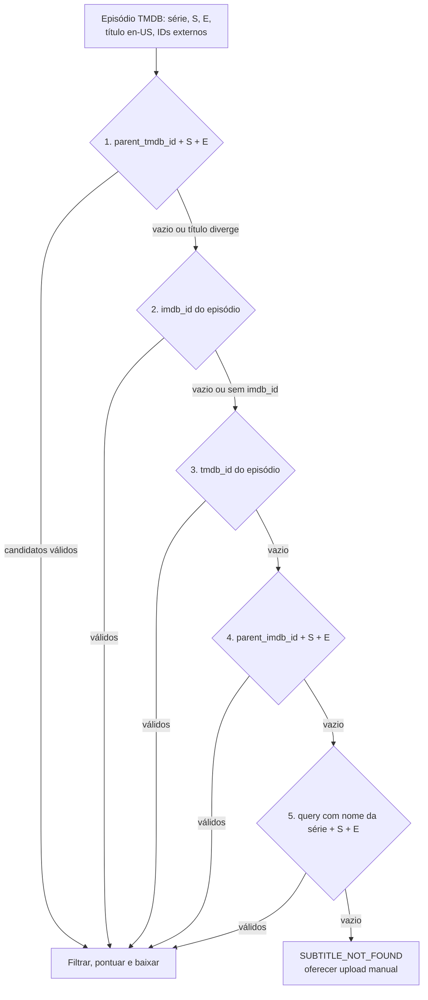

# 4. Integrações

Três integrações, todas no backend, cada uma atrás de um cliente com timeout, retry e erros tipados. O navegador nunca fala com elas diretamente (exceto imagens da TMDB).

```
server/integrations/
  tmdb/           client.ts · mappers.ts · types.ts · errors.ts
  opensubtitles/  client.ts · query.ts · resolve.ts · selection.ts · titleMatch.ts
                  tokenStore.ts · quotaStore.ts · types.ts · errors.ts
  llm/            provider.ts · anthropic.ts · fake.ts · cost.ts
server/lib/       http.ts (fetch com timeout) · retry.ts · logger.ts
```

---

## 4.1 TMDB

### 4.1.1 Autenticação e base
- Base: `https://api.themoviedb.org/3`. ✅
- Cabeçalhos: `Authorization: Bearer ${TMDB_READ_TOKEN}` (o "API Read Access Token" da sua conta) e `Accept: application/json`. ✅
- O token fica só no servidor. A TMDB tolera chave no cliente, mas o proxy centraliza cache, rate limit e normalização.

### 4.1.2 Endpoints usados

| Uso | Rota | Parâmetros | Campos aproveitados | Cache na CDN |
|---|---|---|---|---|
| Buscar séries | `GET /search/tv` | `query`, `page`, `language=pt-BR`, `include_adult=false` | `page`, `total_pages`, `total_results`, `results[].id`, `name`, `original_name`, `first_air_date`, `poster_path`, `overview`, `original_language` | 1 h |
| Detalhes da série | `GET /tv/{series_id}` | `language=pt-BR`, `append_to_response=external_ids` | `name`, `original_name`, `overview`, `poster_path`, `backdrop_path`, `first_air_date`, `last_air_date`, `number_of_seasons`, `original_language`, `seasons[]` (`season_number`, `name`, `episode_count`, `air_date`, `poster_path`), `external_ids.imdb_id` | 24 h |
| Episódios (tela) | `GET /tv/{series_id}/season/{season_number}` | `language=pt-BR` | `episodes[]`: `id`, `episode_number`, `season_number`, `name`, `overview`, `still_path`, `runtime`, `air_date` | 24 h |
| Episódios (fallback EN) | mesma rota | `language=en-US` | `name`, `overview` para preencher vazios | 24 h |
| Resolver a legenda | `GET /tv/{series_id}/season/{s}/episode/{e}` | `language=en-US`, `append_to_response=external_ids` | `id`, `name` (título EN, usado na validação), `runtime`, `air_date`, `external_ids.imdb_id` | gravado em `episodes` |
| IDs externos (se o append não vier) | `GET /tv/{series_id}/season/{s}/episode/{e}/external_ids` | — | `imdb_id`, `tvdb_id` | idem |
| Configuração de imagens | `GET /configuration` | — | `images.secure_base_url`, `poster_sizes`, `still_sizes` | 7 dias |

### 4.1.3 Normalização (mappers)
- `firstAirYear` = 4 primeiros caracteres de `first_air_date`, ou `null`.
- Nome da série: `name` (pt-BR); se vazio, `original_name`.
- Sinopse: se a pt-BR vier vazia, usar a en-US e marcar `overviewLang: "en"`.
- Título de episódio genérico em pt-BR (regex `/^epis[oó]dio\s+\d+$/i`) é trocado pelo título en-US, com `nameLang: "en"`.
- A API devolve **caminhos** de imagem; o front monta a URL com `imageBaseUrl` vindo de `GET /api/config` (item 6).

### 4.1.4 Imagens
- URL = `secure_base_url` + tamanho + caminho; ex.: `https://image.tmdb.org/t/p/w342/abc123.jpg`. ✅
- Tamanhos: pôster `w154` (1x) e `w342` (2x) na lista; `w342`/`w500` no cabeçalho; still `w185`/`w300`. Ler as listas de `/configuration` e usar essas como fallback.
- `loading="lazy"`, `decoding="async"` e `aspect-ratio` fixo (evita salto de layout). Sem imagem: placeholder com as iniciais.
- Imagens nunca são copiadas nem cacheadas pelo backend.

### 4.1.5 Erros e retries

| HTTP da TMDB | Significado | Ação | Código na nossa API (item 6) |
|---|---|---|---|
| 401 | Token inválido | Não repetir; log de alerta | `UPSTREAM_AUTH_FAILED` (502) |
| 404 | Série, temporada ou episódio inexistente | Não repetir | `SERIES_NOT_FOUND`, `SEASON_NOT_FOUND`, `EPISODE_NOT_FOUND` (404) |
| 429 | Limite de requisições | Até 2 retries, respeitando `Retry-After` (senão 1 s, 2 s) | `UPSTREAM_RATE_LIMITED` (503) |
| 5xx ou timeout (5 s) | Indisponível | Até 2 retries (0,5 s e 1,5 s, com jitter) | `UPSTREAM_UNAVAILABLE` (503) ou `UPSTREAM_TIMEOUT` (504) |

Com a TMDB fora do ar, o catálogo continua saindo da CDN (`stale-while-revalidate`) e os quizzes prontos funcionam, porque o documento do quiz carrega nomes de série e episódio.

### 4.1.6 Limites
O teto informado é da ordem de 40 requisições por segundo; nosso uso é ordens de grandeza menor. ✅ Na pré-geração em lote, no máximo 4 chamadas simultâneas.

### 4.1.7 Termos e atribuição
- Uso gratuito só para fins não comerciais; uso comercial exige licença. ✅
- Atribuição obrigatória ✅, na tela **Sobre/Créditos**:
  - logo da lista de logos aprovados (themoviedb.org/about/logos-attribution), sem alterar cor, proporção ou orientação, e menos proeminente que a marca do app;
  - o aviso exatamente assim: "This product uses the TMDB API but is not endorsed or certified by TMDB."
  - referir-se ao serviço como "TMDB" ou "The Movie Database", com link para `https://www.themoviedb.org`.
- Cache por no máximo 6 meses (ADR-010). ✅
- IA: os termos mencionam treino e validação de sistemas de IA. ⚠️ Ler a cláusula vigente nos API Terms. Nosso uso não treina modelos; mesmo assim, por padrão **nenhum dado da TMDB vai para a LLM**: o título da série e do episódio no prompt vêm do `feature_details` da própria OpenSubtitles quando disponível (ou do arquivo enviado pelo usuário).

---

## 4.2 OpenSubtitles

### 4.2.1 Credenciais e cabeçalhos
| Credencial | Onde obter | Uso |
|---|---|---|
| `OPENSUBTITLES_API_KEY` | Perfil → "API consumers" → criar consumer | Cabeçalho `Api-Key` em toda chamada. A doc pede que a chave seja do desenvolvedor, nunca digitada pelo usuário final ✅ |
| `OPENSUBTITLES_USERNAME` / `OPENSUBTITLES_PASSWORD` | Sua conta gratuita | `POST /login` → JWT para `/download` |
| `OPENSUBTITLES_USER_AGENT` | Definido por nós: `SegundaTela v0.1.0` | Cabeçalho `User-Agent` obrigatório e descritivo; agentes genéricos podem ser bloqueados ✅ |

Sempre enviar também `Accept: application/json`, e `Content-Type: application/json` nos `POST`.

### 4.2.2 Por que fazer login (e não usar só a API key)
- Sem login, a cota é de 5 downloads por 24 h **por IP**; com conta gratuita, 20 por usuário; VIP, 1.000. ✅
- As funções da Vercel saem por IPs compartilhados com outros clientes: a cota anônima por IP pode já estar gasta por terceiros. Com login, a cota é da sua conta e previsível.
- Modo "Under Development" do consumer (até 100 downloads/dia sem login, temporário, citado em versões antigas da doc). ⚠️ Útil só em desenvolvimento local; nunca depender dele em produção.

### 4.2.3 Endpoints usados

| Endpoint | Uso | Autenticação | Observações |
|---|---|---|---|
| `POST /login` | Obter `token` e `base_url` | `Api-Key` | Corpo `{username, password}`. Resposta inclui `user` (cota, nível, VIP ⚠️ campos exatos). O login tem limite próprio (~1/s) ⚠️: reaproveitar o token, nunca logar a cada job |
| `GET /subtitles` | Buscar candidatos | `Api-Key` | Até 50 resultados por página (fixo) ✅. Não consome cota de download |
| `POST /download` | Pedir o link do arquivo | `Api-Key` + `Authorization: Bearer` | Corpo `{file_id, sub_format: "srt"}`. Resposta: `link`, `file_name`, `requests`, `remaining`, `message`, `reset_time`, `reset_time_utc` ✅. **Consome 1 download** |
| `GET {link}` | Baixar o arquivo | — | Link temporário: baixar na hora, nunca guardar |
| `GET /infos/user` | Consultar cota restante | `Api-Key` + Bearer | Opcional, quando o estado da cota é desconhecido ⚠️ campos |

- **Base dinâmica:** depois do login, usar o host de `base_url` (contas VIP podem receber `vip-api.opensubtitles.com`) nas chamadas seguintes. ✅
- **Validade do token:** não confirmei na doc ⚠️. Estratégia: guardar token + host por 12 h (o mesmo prazo usado pelo Bazarr) e refazer o login uma vez ao receber 401.
- **Onde guardar:** cache em memória do módulo + linha `provider_state` (`opensubtitles.session`) cifrada com AES-256-GCM (`TOKEN_ENCRYPTION_KEY`), para não logar a cada instância nova.

### 4.2.4 Montagem da query
Regras da doc de boas práticas ✅: parâmetros em ordem alfabética; chaves e valores em minúsculas; IMDb sem `tt` e sem zeros à esquerda em qualquer ID; não enviar valores padrão (`ai_translated=include`, `machine_translated=exclude`); `+` no lugar de `%20`; evitar `order_by` (ordenação no servidor é cara e reduz acerto de cache), então ordenamos localmente.

```ts
// server/integrations/opensubtitles/query.ts
const DEFAULTS: Record<string, string> = {
  ai_translated: 'include',
  machine_translated: 'exclude',
  hearing_impaired: 'include',
};

const stripImdb = (v: string) => v.replace(/^tt/, '').replace(/^0+/, '');
const stripZeros = (v: string) => (/^\d+$/.test(v) ? String(Number(v)) : v);

export function buildSubtitleQuery(params: Record<string, string | number | undefined>): string {
  return Object.entries(params)
    .filter(([, v]) => v !== undefined && v !== '')
    .map(([k, v]) => {
      const key = k.toLowerCase();
      const raw = String(v).trim().toLowerCase();
      const value = key.endsWith('imdb_id') ? stripImdb(raw) : key.endsWith('_id') ? stripZeros(raw) : raw;
      return [key, value] as const;
    })
    .filter(([k, v]) => DEFAULTS[k] !== v)
    .sort(([a], [b]) => (a < b ? -1 : a > b ? 1 : 0))
    .map(([k, v]) => `${k}=${encodeURIComponent(v).replace(/%20/g, '+')}`)
    .join('&');
}
```

Consultas por estratégia (valores entre `<>` são do episódio):

```
E1  /subtitles?ai_translated=exclude&episode_number=<E>&foreign_parts_only=exclude&languages=en&parent_tmdb_id=<SERIE_TMDB>&season_number=<S>
E2  /subtitles?ai_translated=exclude&foreign_parts_only=exclude&imdb_id=<EP_IMDB_SEM_TT>&languages=en
E3  /subtitles?ai_translated=exclude&foreign_parts_only=exclude&languages=en&tmdb_id=<EP_TMDB>
E4  /subtitles?ai_translated=exclude&episode_number=<E>&foreign_parts_only=exclude&languages=en&parent_imdb_id=<SERIE_IMDB_SEM_TT>&season_number=<S>
E5  /subtitles?ai_translated=exclude&episode_number=<E>&foreign_parts_only=exclude&languages=en&query=<nome+da+serie>&season_number=<S>&type=episode
```

- `ai_translated=exclude` descarta traduções feitas por IA; `machine_translated` já vem excluído por padrão. ✅
- `foreign_parts_only=exclude`: o padrão não está claro ⚠️. Se a API responder com redirect (sinal de parâmetro "padrão"), registrar no log e remover do builder.
- `hearing_impaired` e `trusted_sources` não são enviados: entram na pontuação (§4.2.7).

### 4.2.5 Mapeamento de IDs: estratégia com fallbacks
A doc considera melhor o ID da série + temporada + episódio; como alternativa, o ID do próprio episódio enviado sozinho. ✅ Como a numeração diverge entre bases (exemplo de Victorious em 0.3, D1), toda estratégia baseada em número passa por **validação de título**.



| Ordem | Estratégia | Requer | Validação de cada resultado |
|---|---|---|---|
| 1 | `parent_tmdb_id` + `season_number` + `episode_number` | — | V1 |
| 2 | `imdb_id` do episódio (enviado sozinho) | `external_ids.imdb_id` do episódio | V2 (IMDb) + título, se disponível |
| 3 | `tmdb_id` do episódio (enviado sozinho) | ID do episódio na TMDB | V2 (TMDB) + título, se disponível |
| 4 | `parent_imdb_id` + S + E | `external_ids.imdb_id` da série | V1 |
| 5 | `query` = nome da série + S + E + `type=episode` | — | V1 + `parent_title` parecido com o nome da série (≥ 0,8) |
| 6 | Upload manual pelo usuário ([MVP+]) | arquivo | QA do parser |

- **V1 (estratégias por número):** `feature_details.season_number` e `episode_number` iguais aos pedidos (quando presentes) **e** similaridade de título ≥ 0,80 entre `feature_details.title` e o título en-US da TMDB. Se o título da TMDB faltar ou for genérico (`/^episode \d+$/i`), pula a checagem de título.
- **V2 (estratégias por ID):** `feature_details.imdb_id` (como inteiro) ou `feature_details.tmdb_id` igual ao ID pedido, quando o campo vier.
- Se a estratégia 1 trouxer resultados mas **todos** com título divergente, o job registra `numbering_mismatch` e segue para as estratégias por ID (2 e 3). Se nenhuma validar, falha com `SUBTITLE_NOT_FOUND` e detalhe "numeração divergente"; a UI sugere o upload.
- Para na primeira estratégia com ≥ 1 candidato aprovado nos filtros (§4.2.6). Cada tentativa é uma busca (não gasta cota). A estratégia vencedora fica em `subtitle_selections.strategy`.
- **Similaridade de título** (`titleMatch.ts`): normaliza (minúsculas, remove acentos e pontuação, colapsa espaços, `part one|1|i` → `part 1`, remove artigo inicial "the") e calcula `max(jaccardDeTokens, jaroWinkler)`. Casos de teste no item 7 (SIM-01..04).
- Campos de `feature_details` (`title`, `parent_title`, `season_number`, `episode_number`, `imdb_id`, `tmdb_id`, `parent_imdb_id`, `parent_tmdb_id`) aparecem no exemplo de resposta da doc. ⚠️ Confirmar nomes e tipos com a fixture gravada na Fase 1.

### 4.2.6 Filtros obrigatórios (antes de pontuar)
1. `language === "en"`.
2. `ai_translated === false` e `machine_translated === false`.
3. `foreign_parts_only === false` (legendas "forced" cobrem só falas estrangeiras).
4. `files.length === 1` (arquivo único; vários CDs ficam de fora).
5. Validação V1/V2 da estratégia usada.
6. `release` ou `comments` sem indícios de tradução automática: `/machine|google translat|auto[- ]?translat|\bai[- ]translat/i`.

### 4.2.7 Pontuação e escolha
```ts
// server/integrations/opensubtitles/selection.ts
export function scoreCandidate(a: OsSubtitleAttributes, now = Date.now()): number {
  let s = 0;
  if (a.from_trusted) s += 40;                                            // fonte confiável
  if (!a.hearing_impaired) s += 20;                                       // preferir sem HI (decisão A2)
  s += Math.min(30, 10 * Math.log10(1 + (a.download_count ?? 0)));        // popularidade, com teto
  if ((a.votes ?? 0) >= 3) s += 2 * (a.ratings ?? 0);                     // nota 0–10, só com votos
  if (/\b(web[-. ]?(dl|rip)|amzn|nf|dsnp|hmax|atvp|pcok)\b/i.test(a.release ?? '')) s += 5; // origem streaming
  const ageYears = (now - Date.parse(a.upload_date)) / (365.25 * 24 * 3600 * 1000);
  if (Number.isFinite(ageYears) && ageYears < 3) s += 5 * (1 - ageYears / 3); // revisões recentes
  return Math.round(s * 10) / 10;
}
```
- Ordena por `score` desc; desempate por `download_count` desc e depois `upload_date` mais recente.
- Os **2 melhores** são candidatos a download; o 2º só é usado se o 1º for reprovado no QA do parser (item 7).
- O bônus "origem streaming" existe porque legendas tiradas de WEB-DL tendem a ter tempos mais próximos do que você assiste no streaming.
- Os 5 primeiros candidatos (só metadados) ficam salvos em `subtitle_selections.candidates` para auditoria.

### 4.2.8 Download do arquivo
1. `POST /download` com `{file_id, sub_format: "srt"}`.
2. Gravar **imediatamente** `remaining` e `reset_time_utc` em `provider_state` (`opensubtitles.quota`), antes de qualquer outra coisa.
3. `GET link` com timeout de 15 s; abortar acima de 2 MB.
4. Se os primeiros bytes forem `1F 8B` (gzip), descompactar com `node:zlib`. Se forem `50 4B 03 04` (zip), rejeitar com `SUBTITLE_UNUSABLE` ⚠️ (não esperado com `sub_format`).
5. Entregar os bytes ao pipeline do item 7 (memória apenas).
6. Registrar o download em `subtitle_selections` (aceito ou rejeitado). Ele conta para o limite de 2 downloads por episódio a cada 24 h.

### 4.2.9 Erros, retry e backoff

| Situação | Sinal | Ação | Retry | Código (item 6) |
|---|---|---|---|---|
| Nenhum resultado | `200` com `total_count = 0` | Próxima estratégia; ao fim, falha | — | `SUBTITLE_NOT_FOUND` |
| Token ausente/expirado | `401` em `/download` | Refazer login uma vez e repetir | 1, imediato | (transparente) |
| Credenciais erradas | `401` em `/login` | Falha; log de alerta | não | `UPSTREAM_AUTH_FAILED` (502) |
| Cota esgotada | `406` em `/download`, com `remaining`, `requests`, `reset_time_utc` ✅ | Salvar estado da cota e encerrar | não | `SUBTITLE_QUOTA_EXCEEDED` (503 + `Retry-After`) |
| Limite de requisições | `429` (cabeçalhos `Retry-After`/`X-RateLimit-*` se vierem ⚠️) | Esperar e repetir | até 3: 1 s, 2 s, 4 s com jitter, ou o `Retry-After` | `UPSTREAM_RATE_LIMITED` (503) |
| Limite do login | `429` em `/login` | Não logar em loop; usar token em cache; esperar ≥ 1 s | 1 | `UPSTREAM_RATE_LIMITED` |
| Erro do servidor | `502/503/504` | Repetir | busca: até 2 (0,5 s e 1,5 s); download: 1 | `UPSTREAM_UNAVAILABLE` (503) |
| Timeout no `POST /download` | sem resposta em 10 s | **Não repetir automaticamente** (o download pode ter sido contado) | não | `UPSTREAM_TIMEOUT` (504) |
| Link recusado | `403/404/410` ao baixar o arquivo | Pedir novo link uma vez ⚠️ (pode contar outro download) | 1 | `SUBTITLE_UNUSABLE` |
| Arquivo inválido ou reprovado no QA | parser/QA (item 7) | Próximo candidato, respeitando o limite de 2 downloads | — | `SUBTITLE_UNUSABLE` (422) |
| Redirect | `301/302` | Seguir, mas logar (parâmetro fora do padrão) | — | — |

```ts
// server/lib/retry.ts — backoff exponencial com "full jitter", respeitando Retry-After e o deadline do job
export async function withRetry<T>(
  fn: (attempt: number) => Promise<T>,
  o: { retries: number; baseMs: number; maxMs: number; deadline?: number;
       shouldRetry: (e: unknown) => boolean; retryAfterMs?: (e: unknown) => number | undefined },
): Promise<T> {
  for (let attempt = 0; ; attempt++) {
    try {
      return await fn(attempt);
    } catch (e) {
      if (attempt >= o.retries || !o.shouldRetry(e)) throw e;
      const backoff = Math.random() * Math.min(o.maxMs, o.baseMs * 2 ** attempt);
      const wait = Math.max(o.retryAfterMs?.(e) ?? 0, backoff);
      if (o.deadline && Date.now() + wait > o.deadline) throw e;
      await new Promise((r) => setTimeout(r, wait));
    }
  }
}
```

### 4.2.10 Cota: o projeto inteiro gira em torno de 20 downloads/dia
Fatos ✅: sem login, 5/24 h por IP; conta gratuita, 20; VIP, 1.000; pacotes Pro para apps cujos usuários não fazem login (preços na página "API subscription prices" da doc ⚠️). A busca não tem limite de cota.

Regras de projeto:
1. **Cache permanente por episódio:** download e LLM só acontecem quando não existe quiz `ready`.
2. **No máximo 2 downloads por episódio a cada 24 h** (o reprovado no QA conta).
3. **Falha rápida:** se o estado salvo diz `remaining ≤ 0` e `agora < resetAt`, o `POST` de geração devolve `503 SUBTITLE_QUOTA_EXCEEDED` sem chamar a OpenSubtitles.
4. **Reserva interativa:** a pré-geração nunca usa os últimos `OS_INTERACTIVE_RESERVE` downloads (padrão 5).
5. **Pré-geração diária** (GitHub Actions): roda logo depois do horário de renovação. A renovação parece seguir o `reset_time_utc` devolvido (num caso público, 23:59:59 UTC), mas não está claro se é janela fixa ou móvel ⚠️: observar por uma semana e então fixar o horário do cron.
6. **Mensagem amigável:** "A cota diária de legendas acabou. Renova hoje às 21:00." (conversão de `resetAt` com `Intl.DateTimeFormat` no fuso do aparelho). Quizzes prontos seguem disponíveis.
7. **Métricas:** downloads por dia, reprovações por motivo, `remaining` ao fim do dia.
8. **Caminho de upgrade:** VIP (1.000/dia, mesmo código; preço ⚠️ na página VIP do site) antes de pensar em pacote Pro.

### 4.2.11 Provedores alternativos de legenda

| Opção | Acesso | Prós | Contras | Termos | Recomendação |
|---|---|---|---|---|---|
| **Upload manual** (.srt/.vtt do usuário) | — | Sem cota e sem terceiros; cobre qualquer episódio | Atrito para o usuário | O usuário declara ter direito de uso do arquivo | **Fallback principal** [MVP+] |
| SubDL | API oficial em beta: `GET https://api.subdl.com/api/v1/subtitles` com `api_key`, `tmdb_id`/`imdb_id`, `season_number`, `episode_number`, `languages`; download em `.zip` ✅ | Aceita ID da TMDB; simples | Beta; limites não publicados; relatos de temporada/episódio ausentes nos metadados; zip | ⚠️ ler antes de ligar | Fallback automático **desligado** (`SUBDL_ENABLED=false`) |
| OpenSubtitles VIP | Mesma API | 1.000/dia, zero código novo | Pago | Mesmos termos | Upgrade se a cota estourar com frequência |
| OpenSubtitles pacote Pro | Mesma API | Cotas dedicadas, sem login de usuário | Pago, pensado para apps comerciais | ⚠️ | Desnecessário no MVP |
| Addic7ed, Podnapisi e similares | Sem API pública documentada que eu tenha confirmado ⚠️ | Boa cobertura de séries | Exigiria scraping, sujeito a bloqueio e a termos | ⚠️ | **Não usar** |

Interface comum, para plugar provedores sem mexer no pipeline:
```ts
export interface SubtitleProvider {
  readonly name: 'opensubtitles' | 'subdl' | 'upload';
  findCandidates(ep: ResolvedEpisode): Promise<RankedCandidate[]>;
  fetchFile(c: RankedCandidate): Promise<{ bytes: Uint8Array; meta: DownloadMeta }>;
}
```

### 4.2.12 Checklist de verificação (Fase 1)
- [ ] Script `scripts/os-probe.ts` roda E1–E5 para um episódio de teste (por exemplo, Victorious S01E01 e S01E04) e grava as respostas de `/subtitles` em `tests/fixtures/opensubtitles/` (só metadados; trocar nomes de uploader por `uploader_1`, `uploader_2`…).
- [ ] Confirmar nomes e tipos de `feature_details`, da resposta de `/login` e de `/download`.
- [ ] Confirmar se `foreign_parts_only=exclude` provoca redirect.
- [ ] Observar `reset_time_utc` por alguns dias (janela fixa ou móvel?).
- [ ] Nunca salvar o `.srt` baixado no repositório: pasta `.private/` no `.gitignore`.

---

## 4.3 LLM

### 4.3.1 Interface do provedor
```ts
// server/integrations/llm/provider.ts
export type Effort = 'low' | 'medium' | 'high';

export interface GenerateJsonRequest {
  system: string;                     // instruções fixas (cacheáveis)
  user: string;                       // parte variável: o bloco
  schema: Record<string, unknown>;    // JSON Schema no subconjunto aceito pela saída estruturada
  maxTokens: number;                  // cobre pensamento + JSON
  effort: Effort;
  thinking: 'adaptive' | 'off';
  timeoutMs: number;
  signal?: AbortSignal;
  meta: { jobId: string; segmentId: string; attempt: number };
}

export interface GenerateJsonResult {
  json: unknown | null;               // ainda sem validação semântica
  stopReason: 'end_turn' | 'max_tokens' | 'refusal' | 'other';
  refusalCategory?: string;
  usage: { inputTokens: number; outputTokens: number; cacheReadTokens: number; cacheWriteTokens: number };
  model: string;
  latencyMs: number;
}

export interface LlmProvider {
  readonly name: 'anthropic' | 'openai' | 'fake';
  generateJson(req: GenerateJsonRequest): Promise<GenerateJsonResult>;
}
```
O domínio (`server/domain/quiz/`) só conhece essa interface. Trocar de modelo ou de fornecedor não toca no pipeline.

### 4.3.2 Implementação Anthropic
```ts
// server/integrations/llm/anthropic.ts
import Anthropic from '@anthropic-ai/sdk';

const client = new Anthropic({ apiKey: env.ANTHROPIC_API_KEY, maxRetries: 2 });

export const anthropicProvider: LlmProvider = {
  name: 'anthropic',
  async generateJson(req) {
    const started = Date.now();
    const res = await client.messages.create(
      {
        model: env.LLM_MODEL,                                   // 'claude-sonnet-5-5'
        max_tokens: req.maxTokens,
        system: [{ type: 'text', text: req.system, cache_control: { type: 'ephemeral' } }],
        messages: [{ role: 'user', content: req.user }],
        output_config: {
          effort: req.effort,
          format: { type: 'json_schema', schema: req.schema },
        },
        ...(req.thinking === 'off' ? { thinking: thinkingOff(env.LLM_MODEL) } : {}),
        // NÃO enviar: temperature, top_p, top_k, prefill de assistente, tool_choice forçado
      },
      { signal: req.signal, timeout: req.timeoutMs },
    );
    // Blocos 'thinking' podem vir antes do texto: ler por tipo, nunca content[0]
    const text = res.content.flatMap((b) => (b.type === 'text' ? [b.text] : [])).join('');
    let json: unknown | null = null;
    if (res.stop_reason === 'end_turn') {
      try { json = JSON.parse(text); } catch { json = null; }
    }
    return {
      json,
      stopReason: normalizeStop(res.stop_reason),
      refusalCategory: (res as { stop_details?: { category?: string } }).stop_details?.category, // ⚠️ formato
      usage: {
        inputTokens: res.usage.input_tokens,
        outputTokens: res.usage.output_tokens,
        cacheReadTokens: res.usage.cache_read_input_tokens ?? 0,
        cacheWriteTokens: res.usage.cache_creation_input_tokens ?? 0,
      },
      model: res.model,
      latencyMs: Date.now() - started,
    };
  },
};

// Sonnet 5.5 rejeita {type:'disabled'} e usa 'between_tools' para não pensar antes de responder;
// Haiku 5.5 aceita 'disabled' com esforço até 'high'.
function thinkingOff(model: string) {
  return model.startsWith('claude-sonnet-5-5') ? { type: 'between_tools' as const } : { type: 'disabled' as const };
}
```
Regras confirmadas na documentação ✅:
- Saída estruturada em `output_config.format` (`type: "json_schema"`), GA para `claude-sonnet-5-5` e `claude-haiku-5-5`. O SDK TypeScript também oferece `zodOutputFormat()` com `messages.parse()`, que converte restrições não suportadas em descrição e valida a resposta.
- Limitações do schema que moldam o item 8: `additionalProperties: false` em todo objeto; sem `minLength`/`maxLength` nem limites numéricos; `minItems` só 0 ou 1; no máximo 24 propriedades opcionais e 16 com união de tipos por requisição. Por isso o schema do quiz usa **só campos obrigatórios** e valida tamanhos no código.
- Propriedades obrigatórias saem primeiro, na ordem do schema.
- O caso de `enum` pode vir com capitalização diferente: comparar sem diferenciar maiúsculas.
- Pedir "raciocínio passo a passo" num campo do JSON pode causar recusa `reasoning_extraction`: o schema pede só explicações curtas para o aluno.
- A primeira requisição com um schema novo compila a gramática (latência extra); a compilação fica em cache por 24 h.
- `stop_reason` pode ser `refusal` (cobrado, saída fora do schema) ou `max_tokens` (saída incompleta).
- O tokenizador novo conta cerca de 30% mais tokens que o dos modelos anteriores: medir com o endpoint de contagem antes de calibrar `max_tokens`.

### 4.3.3 Pensamento e esforço

| Configuração | Sonnet 5.5 | Haiku 5.5 | Uso |
|---|---|---|---|
| `LLM_THINKING=adaptive` | padrão (pensamento adaptativo) | padrão | Inicial |
| `LLM_THINKING=off` | `thinking: {type: "between_tools"}` (aceito com esforço `low`/`medium`/`high`) ✅ | `thinking: {type: "disabled"}` (esforço ≤ `high`) ✅ | Testar no eval: mais rápido e barato |
| `LLM_EFFORT` | `medium` (o padrão da API é `high`) | `medium` (padrão do modelo) | Eval compara `low` × `medium` |

### 4.3.4 Erros e retries

| Situação | Sinal | Ação |
|---|---|---|
| Requisição inválida | `400 invalid_request_error` | Bug ou parâmetro proibido: não repetir; bloco falha; log de alerta |
| Chave inválida/sem permissão | `401`/`403` | Não repetir; job falha com `UPSTREAM_AUTH_FAILED` |
| Limite de requisições | `429` com `retry-after` | O SDK repete (até 2); reduzir a concorrência do job para 2 |
| Sobrecarga ou erro interno | `529`/`5xx` | O SDK repete com backoff; depois, só o bloco falha |
| Timeout | > `LLM_TIMEOUT_MS` (120 s) | Abortar o bloco; 1 nova tentativa se couber no deadline do job |
| Recusa | `stop_reason: "refusal"` | Logar a categoria; 1 nova tentativa; repetindo, o bloco fica sem perguntas |
| Saída truncada | `stop_reason: "max_tokens"` | Nova tentativa com `max_tokens × 1,5` (teto 16.000) |
| JSON válido, mas reprovado | validação semântica (item 8) | Regerar o bloco 1 vez com a lista de erros |

Se menos de 60% dos blocos ficarem com perguntas válidas, o job falha com `QUALITY_CHECK_FAILED` e nenhum quiz é gravado.

### 4.3.5 Concorrência e limites da conta
- `LLM_MAX_CONCURRENCY=4` por job. Contas novas têm limites por minuto (requisições e tokens de entrada/saída) definidos pelo tier ⚠️: conferir no Console da Anthropic e baixar a concorrência se aparecer 429 com frequência.
- **Cache de prompt:** as instruções fixas vão no `system` com `cache_control`. O mínimo cacheável no Sonnet 5.5 é 512 tokens ✅; no Haiku 5.5 ⚠️. Chamadas paralelas podem não aproveitar o cache da primeira; no MVP aceitamos isso (custo extra de centavos). Otimização futura: disparar o bloco 1, esperar o início da resposta e só então disparar os demais ⚠️ conferir na doc de prompt caching quando a entrada fica disponível.
- **Configure um limite de gasto mensal** no Console da Anthropic como segunda barreira, além do teto do app.

### 4.3.6 Custo e orçamento
```ts
// server/integrations/llm/cost.ts
export function costUsd(u: GenerateJsonResult['usage'], p: { inPerMTok: number; outPerMTok: number; cacheReadPerMTok: number }) {
  return (
    u.inputTokens * p.inPerMTok +
    u.outputTokens * p.outPerMTok +
    u.cacheWriteTokens * p.inPerMTok * 1.25 + // escrita de cache de 5 min = 1,25× a entrada ⚠️ conferir na tabela de preços
    u.cacheReadTokens * p.cacheReadPerMTok
  ) / 1_000_000;
}
```
- Antes de cada chamada: `gastoHoje + estimativaPessimista ≤ LLM_DAILY_BUDGET_USD`, onde a estimativa é `(caracteresDeEntrada / 3) × preçoEntrada + maxTokens × preçoSaída`. Estourou: o job para com `BUDGET_EXCEEDED` e grava o que já tiver gasto.
- Depois de cada chamada: incremento atômico em `usage_daily` (item 5) e soma em `quizzes.usage`.
- Os preços vêm de variáveis de ambiente (abaixo), não de constantes no código.

### 4.3.7 Provedor falso para testes
`LLM_PROVIDER=fake` devolve JSON de `tests/fixtures/llm/{segmentId}.json` (ou gera perguntas determinísticas a partir das linhas recebidas), com latência configurável e falhas simuladas (`FAKE_LLM_FAIL=refusal|max_tokens|429`). Todos os testes de contrato e E2E usam o falso; só o eval chama a API real.

### 4.3.8 Outro fornecedor
Se o eval indicar outro fornecedor, basta implementar `LlmProvider` (por exemplo, `openai.ts`) usando o mesmo JSON Schema gerado por `z.toJSONSchema()`. ⚠️ Conferir a forma atual de saída estruturada na API escolhida.

### 4.3.9 Variáveis de ambiente da LLM

| Variável | Padrão | Observação |
|---|---|---|
| `LLM_PROVIDER` | `anthropic` | `fake` em testes |
| `ANTHROPIC_API_KEY` | — | Só no servidor |
| `LLM_MODEL` | `claude-sonnet-5-5` | Candidato: `claude-haiku-5-5` |
| `LLM_EFFORT` | `medium` | `low` / `medium` / `high` |
| `LLM_THINKING` | `adaptive` | `off` mapeia para a configuração de cada modelo (§4.3.3) |
| `LLM_MAX_TOKENS_PER_SEGMENT` | `8000` | Recalibrar após medir |
| `LLM_MAX_CONCURRENCY` | `4` | |
| `LLM_TIMEOUT_MS` | `120000` | |
| `LLM_PRICE_IN_PER_MTOK` | `2` | Sonnet 5.5 ✅; Haiku 5.5: `0.10` ⚠️ |
| `LLM_PRICE_OUT_PER_MTOK` | `10` | Haiku 5.5: `0.50` ⚠️ |
| `LLM_PRICE_CACHE_READ_PER_MTOK` | `0.10` | Sonnet 5.5 ✅ |
| `LLM_DAILY_BUDGET_USD` | `1.00` | Corte automático |
| `QUIZ_INCLUDE_PT_EXPLANATION` | `true` | D6 |

---

## 4.4 Chamadas externas por geração

| Serviço | Chamadas por job | Consome cota? |
|---|---|---|
| TMDB | 1–2 (episódio en-US com IDs externos; IDs externos avulsos se preciso) | Não |
| OpenSubtitles `/login` | 0–1 (token em cache por 12 h) | Não |
| OpenSubtitles `/subtitles` | 1–5 (uma por estratégia) | Não |
| OpenSubtitles `/download` | 1–2 | **Sim, 1 por chamada** |
| Link do arquivo | 1–2 | Não |
| LLM | n blocos (sitcom ≈ 4; drama ≈ 9) + até n novas tentativas | US$ (item 8) |
