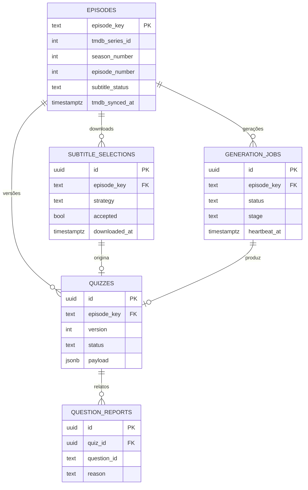

# 5. Modelo de dados

## 5.1 Onde cada dado vive

| Dado | Onde | Por quê | Retenção |
|---|---|---|---|
| Quiz (documento com blocos e perguntas) | Postgres `quizzes.payload` (JSONB) | Global, imutável por versão, lido de uma vez | Até ser substituído ou retirado |
| Metadados mínimos do episódio | Postgres `episodes` | Chave do cache, validação de título, status da busca de legenda | Campos da TMDB renovados antes de 150 dias; apagados aos 170 se não renovarem (IDs ficam) |
| Escolha da legenda (só metadados) | Postgres `subtitle_selections` | Auditoria; limite de 2 downloads por episódio/24 h | 1 ano |
| **Texto da legenda** | **Só memória do job** | Conteúdo protegido (ADR-009) | **Nunca persistido** |
| Jobs de geração | Postgres `generation_jobs` | Progresso, idempotência, métricas | 30 dias (sucesso) / 90 dias (falha) |
| Contadores de rate limit | Postgres `rate_limit_counters` | Anti-abuso | Expiram em ≤ 2 dias |
| Uso diário (tokens, US$, downloads) | Postgres `usage_daily` | Orçamento e painel | Indefinida (1 linha por dia) |
| Sessão e cota da OpenSubtitles | Postgres `provider_state` (sessão cifrada) | Evitar login a cada instância; falha rápida por cota | Sobrescrito |
| Relatos de pergunta com problema | Postgres `question_reports` | Qualidade | 180 dias |
| Fila de pré-geração [MVP+] | Postgres `pregen_queue` | Lote diário | 30 dias após processar |
| Catálogo (busca, série, temporada) | CDN da Vercel | Desempenho | ≤ 24 h (+ até 7 dias servindo "velho" se a TMDB cair) |
| Configurações, tentativas, progresso, favoritos | `localStorage` do aparelho | Sem login no MVP | Até o usuário apagar |
| `deviceId` e código de acesso | `localStorage` | Rate limit por dispositivo; não redigitar o código | Até apagar |

### Comparação de opções de persistência

| Necessidade | Escolha | Alternativas consideradas | Por que não |
|---|---|---|---|
| Quizzes, jobs, contadores | Postgres (Neon) | KV/Redis; blob storage com JSON | KV não faz consultas nem restrições únicas; blob não tem transação nem índice |
| Documento do quiz | JSONB numa linha | Tabela `questions` normalizada | O quiz é lido inteiro e nunca consultado por pergunta; normalizar só adiciona joins. Relatórios usam `jsonb_array_elements` quando preciso |
| Histórico no aparelho | `localStorage` (Zustand `persist`) | IndexedDB (Dexie); servidor | IndexedDB é mais código para volumes de até ~2 MB; servidor exigiria identidade (pós-MVP) |
| Catálogo | Cache da CDN | Tabela de cache no Postgres | Mais código e risco de esquecer o limite de 6 meses |

## 5.2 Diagrama entidade-relacionamento (servidor)



Tabelas sem relação: `rate_limit_counters`, `usage_daily`, `provider_state`, `pregen_queue`.

## 5.3 Schema do servidor (Drizzle)

```ts
// server/db/schema.ts
import { sql } from 'drizzle-orm';
import {
  pgTable, text, integer, boolean, real, jsonb, timestamp, date, uuid,
  numeric, bigint, primaryKey, index, uniqueIndex,
} from 'drizzle-orm/pg-core';
import type { QuizDocument, QuizUsage, QuizQuality } from '@shared/contracts/quiz';
import type { CandidateSummary, ParserStats, QaResult } from '@shared/contracts/subtitles';

const ts = (name: string) => timestamp(name, { withTimezone: true });

export const JOB_STAGES = ['queued', 'resolving', 'searching', 'downloading', 'parsing',
  'generating', 'validating', 'ready', 'failed'] as const;

export const episodes = pgTable('episodes', {
  episodeKey: text('episode_key').primaryKey(),               // tmdb-1234-s01-e04
  tmdbSeriesId: integer('tmdb_series_id').notNull(),
  seasonNumber: integer('season_number').notNull(),
  episodeNumber: integer('episode_number').notNull(),
  tmdbEpisodeId: integer('tmdb_episode_id'),
  imdbEpisodeId: text('imdb_episode_id'),                     // 'tt0000000'
  imdbSeriesId: text('imdb_series_id'),
  // Metadados da TMDB: renovar antes de 150 dias; anular aos 170 sem renovação
  seriesName: text('series_name'),
  episodeNameEn: text('episode_name_en'),
  episodeNamePt: text('episode_name_pt'),
  runtimeMin: integer('runtime_min'),
  airDate: date('air_date'),
  originalLanguage: text('original_language'),
  tmdbSyncedAt: ts('tmdb_synced_at'),
  // Resultado da última busca de legenda
  subtitleStatus: text('subtitle_status', {
    enum: ['unknown', 'found', 'not_found', 'numbering_mismatch'],
  }).notNull().default('unknown'),
  subtitleCheckedAt: ts('subtitle_checked_at'),
  createdAt: ts('created_at').notNull().defaultNow(),
  updatedAt: ts('updated_at').notNull().defaultNow(),
}, (t) => [
  index('episodes_series_season_idx').on(t.tmdbSeriesId, t.seasonNumber),
  index('episodes_tmdb_synced_idx').on(t.tmdbSyncedAt),
]);

export const subtitleSelections = pgTable('subtitle_selections', {
  id: uuid('id').primaryKey().defaultRandom(),
  episodeKey: text('episode_key').notNull().references(() => episodes.episodeKey),
  jobId: uuid('job_id'),
  provider: text('provider', { enum: ['opensubtitles', 'upload', 'subdl'] }).notNull(),
  strategy: text('strategy', {
    enum: ['parent_tmdb', 'imdb_episode', 'tmdb_episode', 'parent_imdb', 'query', 'upload'],
  }).notNull(),
  providerSubtitleId: text('provider_subtitle_id'),
  providerFileId: text('provider_file_id'),
  release: text('release'),
  language: text('language').notNull().default('en'),
  hearingImpaired: boolean('hearing_impaired'),
  fromTrusted: boolean('from_trusted'),
  downloadCount: integer('download_count'),
  ratings: real('ratings'),
  votes: integer('votes'),
  uploadDate: ts('upload_date'),
  score: real('score'),
  candidates: jsonb('candidates').$type<CandidateSummary[]>(), // top 5, só metadados
  fileSha256: text('file_sha256'),                              // hash, nunca conteúdo
  fileBytes: integer('file_bytes'),
  encoding: text('encoding'),
  format: text('format', { enum: ['srt', 'vtt'] }),
  parserStats: jsonb('parser_stats').$type<ParserStats>(),
  qa: jsonb('qa').$type<QaResult>(),
  accepted: boolean('accepted').notNull(),
  rejectionReason: text('rejection_reason'),
  downloadedAt: ts('downloaded_at').notNull().defaultNow(),
}, (t) => [index('subsel_episode_time_idx').on(t.episodeKey, t.downloadedAt)]);

export const quizzes = pgTable('quizzes', {
  id: uuid('id').primaryKey().defaultRandom(),
  episodeKey: text('episode_key').notNull().references(() => episodes.episodeKey),
  version: integer('version').notNull(),
  status: text('status', { enum: ['ready', 'superseded', 'withdrawn'] }).notNull().default('ready'),
  schemaVersion: text('schema_version').notNull(),              // '1.0'
  promptVersion: text('prompt_version').notNull(),              // 'quiz-2026-10-v1'
  provider: text('provider').notNull(),
  model: text('model').notNull(),
  effort: text('effort'),
  source: text('source', { enum: ['opensubtitles', 'upload', 'subdl'] }).notNull(),
  subtitleSelectionId: uuid('subtitle_selection_id').references(() => subtitleSelections.id),
  segmentCount: integer('segment_count').notNull(),
  questionCount: integer('question_count').notNull(),
  payload: jsonb('payload').$type<QuizDocument>().notNull(),
  usage: jsonb('usage').$type<QuizUsage>().notNull(),
  quality: jsonb('quality').$type<QuizQuality>().notNull(),
  createdAt: ts('created_at').notNull().defaultNow(),
}, (t) => [
  uniqueIndex('quizzes_episode_version_uq').on(t.episodeKey, t.version),
  uniqueIndex('quizzes_ready_episode_uq').on(t.episodeKey).where(sql`status = 'ready'`),
]);

export const generationJobs = pgTable('generation_jobs', {
  id: uuid('id').primaryKey().defaultRandom(),
  episodeKey: text('episode_key').notNull().references(() => episodes.episodeKey),
  status: text('status', { enum: ['queued', 'running', 'ready', 'failed'] }).notNull().default('queued'),
  stage: text('stage', { enum: JOB_STAGES }).notNull().default('queued'),
  progress: integer('progress').notNull().default(0),
  segmentsDone: integer('segments_done').notNull().default(0),
  segmentsTotal: integer('segments_total'),
  source: text('source', { enum: ['interactive', 'pregen', 'upload'] }).notNull(),
  errorCode: text('error_code'),
  errorDetail: text('error_detail'),                            // sanitizado: nunca texto de legenda
  quizId: uuid('quiz_id'),
  deviceHash: text('device_hash'),
  ipHash: text('ip_hash'),
  createdAt: ts('created_at').notNull().defaultNow(),
  startedAt: ts('started_at'),
  heartbeatAt: ts('heartbeat_at'),
  finishedAt: ts('finished_at'),
  deadlineAt: ts('deadline_at').notNull(),
}, (t) => [
  uniqueIndex('jobs_active_episode_uq').on(t.episodeKey).where(sql`status in ('queued','running')`),
  index('jobs_status_created_idx').on(t.status, t.createdAt),
]);

export const rateLimitCounters = pgTable('rate_limit_counters', {
  bucket: text('bucket').notNull(),                             // 'gen:ip:<hash>'
  windowStart: ts('window_start').notNull(),
  count: integer('count').notNull().default(0),
  expiresAt: ts('expires_at').notNull(),
}, (t) => [
  primaryKey({ columns: [t.bucket, t.windowStart] }),
  index('rl_expires_idx').on(t.expiresAt),
]);

export const usageDaily = pgTable('usage_daily', {
  day: date('day').primaryKey(),                                // dia em UTC
  generationsStarted: integer('generations_started').notNull().default(0),
  generationsReady: integer('generations_ready').notNull().default(0),
  generationsFailed: integer('generations_failed').notNull().default(0),
  subtitleDownloads: integer('subtitle_downloads').notNull().default(0),
  llmCalls: integer('llm_calls').notNull().default(0),
  inputTokens: bigint('input_tokens', { mode: 'number' }).notNull().default(0),
  outputTokens: bigint('output_tokens', { mode: 'number' }).notNull().default(0),
  cacheReadTokens: bigint('cache_read_tokens', { mode: 'number' }).notNull().default(0),
  cacheWriteTokens: bigint('cache_write_tokens', { mode: 'number' }).notNull().default(0),
  costUsd: numeric('cost_usd', { precision: 10, scale: 4 }).notNull().default('0'),
});

export const providerState = pgTable('provider_state', {
  key: text('key').primaryKey(),        // 'opensubtitles.session' | 'opensubtitles.quota'
  value: jsonb('value').notNull(),      // sessão: { iv, ciphertext, tag } (AES-256-GCM)
  expiresAt: ts('expires_at'),
  updatedAt: ts('updated_at').notNull().defaultNow(),
});

export const questionReports = pgTable('question_reports', {
  id: uuid('id').primaryKey().defaultRandom(),
  quizId: uuid('quiz_id').notNull().references(() => quizzes.id),
  questionId: text('question_id').notNull(),
  reason: text('reason', { enum: ['wrong_answer', 'visual', 'spoiler', 'confusing', 'other'] }).notNull(),
  comment: text('comment'),                                     // opcional, ≤ 280 caracteres
  deviceHash: text('device_hash'),
  createdAt: ts('created_at').notNull().defaultNow(),
}, (t) => [index('reports_quiz_idx').on(t.quizId)]);

export const pregenQueue = pgTable('pregen_queue', {
  id: uuid('id').primaryKey().defaultRandom(),
  episodeKey: text('episode_key').notNull(),
  priority: integer('priority').notNull().default(100),
  status: text('status', { enum: ['pending', 'done', 'skipped', 'failed'] }).notNull().default('pending'),
  attempts: integer('attempts').notNull().default(0),
  lastError: text('last_error'),
  createdAt: ts('created_at').notNull().defaultNow(),
  processedAt: ts('processed_at'),
}, (t) => [uniqueIndex('pregen_pending_uq').on(t.episodeKey).where(sql`status = 'pending'`)]);
```

Valores de `provider_state`:
- `opensubtitles.session` → `{ iv, ciphertext, tag }` com `{ token, baseHost, loggedInAt }` cifrado; `expiresAt` = login + 12 h.
- `opensubtitles.quota` → `{ remaining, requests, resetAt, observedAt }` (sem cifra).

## 5.4 Consultas críticas

```sql
-- Quiz pronto de um episódio
SELECT id, version, payload, created_at
FROM quizzes WHERE episode_key = $1 AND status = 'ready';

-- Criar job de forma idempotente (o índice parcial garante 1 job ativo por episódio)
INSERT INTO generation_jobs (episode_key, source, device_hash, ip_hash, deadline_at)
VALUES ($1, $2, $3, $4, now() + interval '240 seconds')
ON CONFLICT (episode_key) WHERE status IN ('queued','running') DO NOTHING
RETURNING id;
-- Sem linha retornada: SELECT id FROM generation_jobs WHERE episode_key = $1 AND status IN ('queued','running');

-- Rate limit (janela fixa; window_start calculado no app: floor(now / janela) * janela)
INSERT INTO rate_limit_counters (bucket, window_start, count, expires_at)
VALUES ($1, $2, 1, $2 + $3::interval)
ON CONFLICT (bucket, window_start) DO UPDATE SET count = rate_limit_counters.count + 1
RETURNING count;

-- Uso diário (incremento atômico após cada chamada à LLM)
INSERT INTO usage_daily (day, llm_calls, input_tokens, output_tokens, cache_read_tokens, cache_write_tokens, cost_usd)
VALUES ((now() AT TIME ZONE 'utc')::date, 1, $1, $2, $3, $4, $5)
ON CONFLICT (day) DO UPDATE SET
  llm_calls = usage_daily.llm_calls + 1,
  input_tokens = usage_daily.input_tokens + EXCLUDED.input_tokens,
  output_tokens = usage_daily.output_tokens + EXCLUDED.output_tokens,
  cache_read_tokens = usage_daily.cache_read_tokens + EXCLUDED.cache_read_tokens,
  cache_write_tokens = usage_daily.cache_write_tokens + EXCLUDED.cache_write_tokens,
  cost_usd = usage_daily.cost_usd + EXCLUDED.cost_usd;

-- Downloads do episódio nas últimas 24 h (limite: 2)
SELECT count(*) FROM subtitle_selections
WHERE episode_key = $1 AND provider <> 'upload' AND downloaded_at > now() - interval '24 hours';

-- Status dos quizzes de uma temporada (tela de episódios)
SELECT e.episode_number, e.subtitle_status, e.subtitle_checked_at,
       q.id AS quiz_id, j.id AS active_job_id, lf.error_code AS last_error_code, lf.finished_at AS last_failed_at
FROM episodes e
LEFT JOIN quizzes q ON q.episode_key = e.episode_key AND q.status = 'ready'
LEFT JOIN generation_jobs j ON j.episode_key = e.episode_key AND j.status IN ('queued','running')
LEFT JOIN LATERAL (
  SELECT error_code, finished_at FROM generation_jobs f
  WHERE f.episode_key = e.episode_key AND f.status = 'failed'
  ORDER BY f.finished_at DESC LIMIT 1
) lf ON true
WHERE e.tmdb_series_id = $1 AND e.season_number = $2;
```

Derivação do status exibido (ordem de precedência): quiz pronto → `ready`; job ativo → `generating`; `subtitle_status` em (`not_found`, `numbering_mismatch`) checado há < 24 h → `no_subtitle`; falha nas últimas 24 h → `failed`; senão → `none`. Episódio sem linha em `episodes` → `none`.

## 5.5 Documento do quiz (`quizzes.payload`)

Contrato compartilhado entre back e front. O schema **de saída da LLM** (item 8) é outro, por bloco; o backend o transforma neste documento após validar, ordenar e mapear IDs de linha para tempos.

```ts
// shared/contracts/quiz.ts
import { z } from 'zod';

export const Level = z.enum(['A2', 'B1', 'B2', 'C1']);
export const QuestionType = z.enum(['comprehension', 'inference', 'vocabulary', 'true_false', 'fill_blank']);
export const OptionId = z.enum(['a', 'b', 'c', 'd']);
export const FocusKind = z.enum(['word', 'phrasal_verb', 'idiom', 'slang', 'collocation', 'grammar']);

export const Evidence = z.object({
  lineIds: z.array(z.string().regex(/^L\d{3,4}$/)).min(1).max(4),
  quote: z.string().min(1).max(120),           // ≤ 15 palavras (checagem à parte)
  startMs: z.number().int().nonnegative(),
  endMs: z.number().int().nonnegative(),
});

export const Question = z.object({
  id: z.string().regex(/^S\d+-Q\d{2}$/),       // 'S2-Q05', estável dentro da versão
  segmentId: z.string().regex(/^S\d+$/),
  order: z.number().int().nonnegative(),       // ordem global, cronológica
  level: Level,
  type: QuestionType,
  prompt: z.string().min(5).max(300),          // inglês
  options: z.array(z.object({ id: OptionId, text: z.string().min(1).max(160) })).min(2).max(4),
  answerId: OptionId,
  explanationEn: z.string().min(5).max(400),
  explanationPt: z.string().max(400),          // '' se desativado
  evidence: Evidence,
  focus: z.object({ expression: z.string().min(1).max(60), kind: FocusKind }).nullable(),
  flags: z.array(z.string()),                  // ex.: 'quote_trimmed'
});

export const Segment = z.object({
  id: z.string().regex(/^S\d+$/),
  index: z.number().int().positive(),
  startMs: z.number().int().nonnegative(),
  endMs: z.number().int().positive(),
  label: z.string(),                           // '00:00–05:12'
  questionIds: z.array(z.string()),
});

export const QuizDocument = z.object({
  schemaVersion: z.literal('1.0'),
  episodeKey: z.string(),
  tmdbSeriesId: z.number().int(),
  seasonNumber: z.number().int(),
  episodeNumber: z.number().int(),
  levels: z.array(Level),
  segments: z.array(Segment),
  questions: z.array(Question),
  source: z.object({
    provider: z.enum(['opensubtitles', 'upload', 'subdl']),
    hearingImpaired: z.boolean().nullable(),
    release: z.string().nullable(),
  }),
  generation: z.object({
    provider: z.string(), model: z.string(), effort: z.string().nullable(),
    promptVersion: z.string(), createdAt: z.string().datetime(),
  }),
});

export type QuizUsage = {
  llmCalls: number; inputTokens: number; outputTokens: number;
  cacheReadTokens: number; cacheWriteTokens: number;
  costUsd: number; latencyMs: number; subtitleDownloads: number;
};
export type QuizQuality = {
  generated: number; kept: number;
  droppedByRule: Record<string, number>;       // ex.: { EVIDENCE_NOT_FOUND: 2 }
  retriedSegments: string[]; emptySegments: string[];
  quoteWordRatio: number;                      // palavras citadas ÷ palavras do diálogo (≤ 0,15)
  flags: string[];                             // ex.: 'hi_subtitle', 'musical_heavy', 'all_caps'
};
```

Observações:
- O documento **não** contém nomes de série/episódio (dados da TMDB). A rota `GET …/quiz` junta esses nomes a partir de `episodes`, que respeita a regra dos 6 meses.
- As citações (`evidence.quote`) e as frases de "complete a lacuna" são os únicos trechos de diálogo armazenados (limites no item 7 e no item 8).

## 5.6 Modelo local (front)

```ts
// src/features/storage/schemas.ts
import { z } from 'zod';
import { Level, OptionId, FocusKind } from '@shared/contracts/quiz';

export const SettingsV1 = z.object({
  level: Level.default('B1'),
  includeNeighborLevels: z.boolean().default(false),
  spoilerFree: z.boolean().default(true),
  theme: z.enum(['system', 'light', 'dark']).default('system'),
  explanationLang: z.enum(['en', 'pt']).default('en'),
  keepScreenOn: z.boolean().default(true),
});

export const AnswerV1 = z.object({
  selected: OptionId, correct: z.boolean(),
  answeredAt: z.string().datetime(), timeMs: z.number().int().nonnegative(),
});

export const AttemptV1 = z.object({
  id: z.string().uuid(),
  quizId: z.string().uuid(), quizVersion: z.number().int(),
  episodeKey: z.string(), seriesId: z.number().int(),
  seasonNumber: z.number().int(), episodeNumber: z.number().int(),
  labels: z.object({                            // dados da TMDB: renovar após 150 dias, anular aos 170
    seriesName: z.string().nullable(), episodeName: z.string().nullable(), fetchedAt: z.string().datetime(),
  }),
  level: Level, includeNeighborLevels: z.boolean(),
  startedAt: z.string().datetime(), updatedAt: z.string().datetime(),
  finishedAt: z.string().datetime().nullable(),
  unlockedSegmentIds: z.array(z.string()),
  answers: z.record(z.string(), AnswerV1),      // por questionId
  skippedQuestionIds: z.array(z.string()),
  summary: z.object({ correct: z.number().int(), total: z.number().int() }).nullable(),
});

export const ArchivedAttemptV1 = AttemptV1.pick({
  id: true, quizId: true, episodeKey: true, seriesId: true, level: true, finishedAt: true, summary: true,
});

export const HistoryV1 = z.object({
  attempts: z.array(AttemptV1).max(500),
  archived: z.array(ArchivedAttemptV1),
});

export const ProgressV1 = z.record(z.string(), z.object({      // chave: seriesId
  lastSeasonNumber: z.number().int(),
  lastEpisodeKey: z.string(),
  watchedEpisodeKeys: z.array(z.string()),
  updatedAt: z.string().datetime(),
}));

export const FavoritesV1 = z.object({
  series: z.array(z.object({ seriesId: z.number().int(), addedAt: z.string().datetime() })),  // [MVP+]
  expressions: z.array(z.object({                                // base dos flashcards [PÓS]
    quizId: z.string().uuid(), questionId: z.string(),
    expression: z.string(), kind: FocusKind, addedAt: z.string().datetime(),
  })),
});

export const DeviceV1 = z.object({
  deviceId: z.string().uuid(),
  createdAt: z.string().datetime(),
  accessCode: z.string().nullable(),
});
```

| Chave no `localStorage` | Conteúdo | Tamanho típico |
|---|---|---|
| `st:v1:settings` | `SettingsV1` | < 1 KB |
| `st:v1:history` | `HistoryV1` | ~1,5–3 KB por tentativa; 500 tentativas ≈ 0,75–1,5 MB |
| `st:v1:progress` | `ProgressV1` | < 50 KB |
| `st:v1:favorites` | `FavoritesV1` | < 100 KB |
| `st:v1:device` | `DeviceV1` | < 1 KB |
| `st:v1:recentSearches` | `string[]` (até 8) | < 1 KB |

Regras:
- Cada store do Zustand tem `version` e `migrate`. Leitura inválida (schema quebrado) é descartada para um backup em `st:corrupt:<timestamp>` e o estado volta ao padrão; nunca derruba o app.
- Exportação: `{ app: "segunda-tela", exportVersion: 1, exportedAt, settings, history, progress, favorites }`. `device` e `accessCode` **não** são exportados.
- Respostas são gravadas a cada resposta (não só no fim), com debounce de 300 ms.
- Acima de ~2 MB no total: migrar o histórico para IndexedDB (ADR-011).

## 5.7 Validade dos dados da TMDB

| Onde | Regra | Mecanismo |
|---|---|---|
| CDN | `s-maxage` ≤ 24 h (+ `stale-while-revalidate` ≤ 7 dias) | Cabeçalhos por rota (item 6) |
| `episodes` (campos da TMDB) | Renovar quando `tmdb_synced_at` > 150 dias; se a renovação falhar até 170 dias, anular os campos da TMDB e manter só IDs e números | Endpoint de manutenção chamado por cron semanal (item 13) |
| `quizzes.payload` | Não contém textos da TMDB | Por construção |
| Histórico local (`labels`) | Renovar com a API quando `fetchedAt` > 150 dias (se online); aos 170 dias, anular os nomes | Verificação ao abrir o histórico |
| Imagens | Nunca armazenadas | URLs apontam para `image.tmdb.org` |

O limite de 6 meses vem dos termos da API (✅ item 4.1.7). IDs numéricos e números de temporada/episódio são mantidos como chaves; se você quiser a leitura mais conservadora possível, o cron também pode re-sincronizar esses registros antes de 170 dias (já está previsto).

## 5.8 O que NÃO armazenar

- Arquivo, texto bruto ou texto limpo da legenda (nem em banco, log, rastreamento de erro, cache, fila ou arquivo temporário).
- Trechos de diálogo além das citações curtas do quiz (≤ 15 palavras cada; ≤ 15% das palavras do episódio no total).
- Letras de música (linhas cantadas são descartadas no parser).
- IP em claro, user agent completo, e-mail ou qualquer PII.
- Credenciais em claro (token da OpenSubtitles só cifrado; senhas e chaves só em variáveis de ambiente).
- Imagens da TMDB ou dados da TMDB por mais de 6 meses.
- Prompts e respostas completas da LLM em log (só contagens, latência, `stop_reason` e códigos de validação).

## 5.9 Tamanho e crescimento

| Item | Tamanho | Volume em 1 ano (10 episódios/dia) |
|---|---|---|
| Quiz de sitcom (4 blocos × 8 perguntas) | ~40 KB | — |
| Quiz de drama (9 blocos × 8 perguntas) | ~85 KB | — |
| Todos os quizzes | — | ~3.650 quizzes ≈ 150–300 MB |
| `subtitle_selections` | ~3 KB por linha | ~13 MB |
| Jobs (com expurgo de 30/90 dias) | ~1 KB | < 1 MB |

O plano gratuito do Neon tem 0,5 GB: suficiente para o primeiro ano mesmo no ritmo máximo da premissa P1. Alerta no painel admin a 70% do espaço.

## 5.10 Migrações e dados de desenvolvimento
- `drizzle-kit generate` cria a migração SQL a partir do schema; `drizzle-kit migrate` aplica (local, preview e produção; item 13). Migrações versionadas em `server/db/migrations/`.
- Índices parciais e `ON CONFLICT … WHERE` precisam aparecer no SQL gerado: conferir na revisão da migração.
- `pnpm db:seed` cria episódios e um quiz **sintético** (diálogo inventado) para desenvolver a UI sem chamar APIs. Nunca usar legenda real em seed ou fixture.
- Expurgo (no endpoint de manutenção): contadores expirados, jobs antigos, relatos com mais de 180 dias, seleções com mais de 1 ano.
