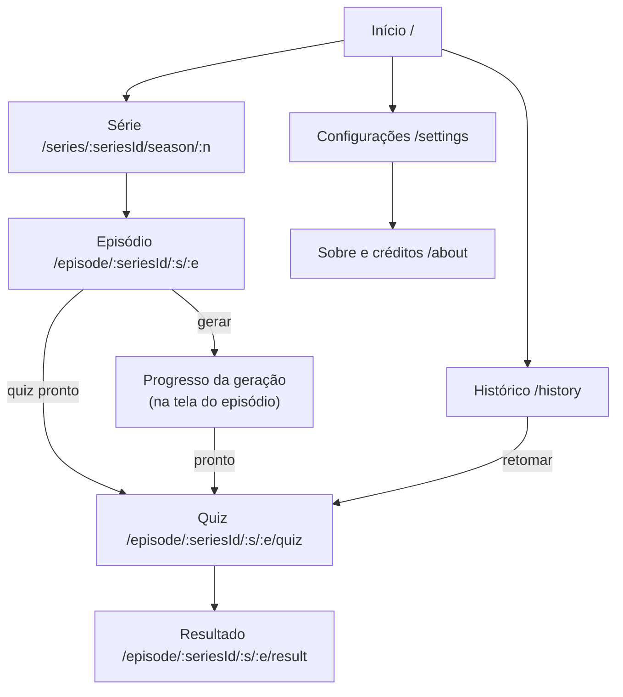

# 9. UI/UX

## 9.1 Princípios
1. **Segunda tela:** o olhar está na TV. Cada tela pede no máximo uma decisão; texto curto; botões grandes ao alcance do polegar (metade inferior).
2. **Escuro por padrão do sistema, confortável no escuro:** tema escuro com fundo quase preto e brilho baixo, sem branco puro.
3. **Sem spoiler:** nada do que ainda não foi assistido aparece sem ação explícita.
4. **Rápido no que já existe:** quiz em cache abre em < 1,5 s; skeletons em vez de spinners.
5. **Honesto nos erros:** cada falha diz o que houve e o que dá para fazer (catálogo §6.5).
6. **Interface em PT-BR, conteúdo em inglês** com `lang="en"` nos elementos em inglês (leitores de tela pronunciam certo).

## 9.2 Mapa de telas e rotas



| Rota | Tela | Dados (TanStack Query) | Navegação |
|---|---|---|---|
| `/` (`?q=`) | Início: busca, buscas recentes, "Continuar" | `['search', q, page]`, `['config']` | barra inferior |
| `/series/:seriesId` | redireciona para a última temporada usada ou a 1 | `['series', id]` | — |
| `/series/:seriesId/season/:n` | Série + episódios | `['series', id]`, `['season', id, n]`, `['quizStatus', id, n]` | barra inferior |
| `/episode/:seriesId/:s/:e` | Episódio: abrir/gerar, progresso, erros | `['quiz', key]`, `['job', jobId]`, `['quota']` | barra inferior |
| `/episode/:seriesId/:s/:e/quiz` | Quiz (modo foco) | `['quiz', key]` + tentativa local | sem barra inferior |
| `/episode/:seriesId/:s/:e/result` | Resultado | tentativa local + `['quiz', key]` | sem barra inferior |
| `/history` | Histórico | local | barra inferior |
| `/settings` | Configurações | local | barra inferior |
| `/about` | Sobre e créditos | `['config']` | — |
| `*` | Não encontrado | — | — |

Barra inferior: **Início · Histórico · Configurações**. Rotas carregadas sob demanda (`React.lazy` + `Suspense`) para manter o JS inicial < 200 KB.

## 9.3 Wireframes (celular, ~380 px)

Episódio, sem quiz ainda:
```
┌────────────────────────────────┐
│ ←  Example Show                │
│ ┌────────────────────────────┐ │
│ │  [still 16:9 – oculto:     │ │
│ │   "Toque para revelar"]    │ │
│ └────────────────────────────┘ │
│ T1 · E02 · The Missing Crown   │
│ 22 min · 03/04/2010            │
│                                │
│ Nível: B1 ▾                    │
│ ┌────────────────────────────┐ │
│ │        Gerar quiz          │ │
│ └────────────────────────────┘ │
│ Leva cerca de 1 minuto. Você   │
│ pode sair desta tela.          │
│ Legendas restantes hoje: 14    │
└────────────────────────────────┘
```

Gerando:
```
│ ✓ Identificando o episódio     │
│ ✓ Procurando legenda em inglês │
│ ✓ Baixando a legenda           │
│ ✓ Limpando o texto             │
│ ● Criando perguntas (2/4)      │
│ ○ Conferindo                   │
│ ▓▓▓▓▓▓▓▓▓▓▓░░░░░  65%          │
│ Pode bloquear o celular: o     │
│ processamento continua.        │
```

Quiz (pergunta):
```
┌────────────────────────────────┐
│ ✕  E02 · Bloco 2 de 4          │
│ 05:12–10:47        3/6 ▓▓▓░░░  │
├────────────────────────────────┤
│ VOCABULÁRIO · B1               │
│ Leo says he is "swamped".      │
│ What does he mean?             │
│ ┌────────────────────────────┐ │
│ │ He has too much work       │ │
│ ├────────────────────────────┤ │
│ │ He is feeling sick         │ │
│ ├────────────────────────────┤ │
│ │ He is bored with it        │ │
│ ├────────────────────────────┤ │
│ │ He is tired of acting      │ │
│ └────────────────────────────┘ │
│  Pular           [ Confirmar ] │
└────────────────────────────────┘
```

Feedback:
```
│ ✓ Correto                      │
│ "Swamped" means having so much │
│ work that you can hardly…      │
│ [ Ver em português ]           │
│ ≈05:31  "I'm swamped with the  │
│ set design."                   │
│ ⚑ Reportar       [ Próxima → ] │
```

Fim do bloco:
```
│ Bloco 2 concluído · 5 de 6 ✓   │
│ Continue assistindo.           │
│ Quando chegar em ≈10:47:       │
│ [ Já assisti até ≈10:47 ]      │
│ Liberar tudo (já vi o episódio)│
```

## 9.4 Árvore de componentes

```
<App>
└─ <Providers>  QueryClientProvider · ThemeProvider · ToastProvider · ErrorBoundary
   ├─ <JobWatcher/>                  acompanha jobs ativos do aparelho; toast "Quiz pronto" em qualquer tela
   └─ <BrowserRouter>
      ├─ <AppShell>                  TopBar · <Outlet/> · BottomNav
      │  ├─ HomePage                 SearchBox · RecentSearches · ContinueCard · SeriesResultList → SeriesCard
      │  ├─ SeriesPage               SeriesHeader · SeasonPicker · NumberingNotice · EpisodeList → EpisodeCard
      │  │                           (TmdbImage · SpoilerReveal · QuizStatusBadge)
      │  ├─ EpisodePage              EpisodeHeader · LevelPicker · QuizActions (OpenQuizButton | GenerateButton)
      │  │                           AccessCodeDialog · GenerationProgress (StepList · ProgressBar)
      │  │                           GenerationError (mensagem + ações) · QuotaInfo
      │  ├─ HistoryPage              SeriesFilter · AttemptList → AttemptRow
      │  ├─ SettingsPage             LevelPicker · ToggleRow × n · ThemePicker · ExportImport [MVP+] · DangerZone
      │  └─ AboutPage                TmdbAttribution · OpenSubtitlesCredit · AiNotice · PrivacySummary · Contact
      └─ <QuizLayout>                sem barra inferior; Wake Lock ativo
         ├─ QuizPage                 QuizTopBar · SegmentGate (UnlockPrompt) · QuestionCard
         │                           (QuestionMeta · QuestionPrompt · OptionList → OptionButton · QuestionActions)
         │                           FeedbackPanel (ResultBanner · Explanation EN/PT · EvidenceQuote · ReportButton [MVP+])
         │                           SegmentSummary (UnlockNextButton · UnlockAllLink)
         └─ ResultPage               ScoreSummary · ScoreBySegment · ScoreByType · WrongAnswersReview · RetryButton
```

Componentes de base (`components/ui`): `Button`, `Card`, `Badge`, `Chip`, `Dialog`, `Toast`, `Skeleton`, `Toggle`, `ProgressBar`, `EmptyState`, `ErrorState`, `VisuallyHidden`.

## 9.5 Estados por tela

| Tela | Carregando | Vazio | Erro | Outros |
|---|---|---|---|---|
| Início | skeleton de 6 cards | sem busca: recentes e "Continuar"; sem resultado: "Nenhuma série encontrada para "{q}"" | `ErrorState` + "Tentar de novo" | offline: aviso + só histórico |
| Série | skeleton de cabeçalho e 8 episódios | temporada sem episódios: "Sem episódios cadastrados" | 404: "Série não encontrada" | sinopse sem PT-BR: selo "EN" |
| Episódio | skeleton do cabeçalho | — | mensagem do código (§6.5) com ação: tentar de novo, enviar legenda [MVP+], ver horário de renovação | cota zerada: botão "Gerar" desabilitado com o horário; sem código: abre `AccessCodeDialog` |
| Geração | lista de etapas com a atual animada (respeitando `prefers-reduced-motion`) | — | etapa com ✕ e mensagem | saiu e voltou: retoma o polling; ficou pronto em outra tela: toast |
| Quiz | skeleton da pergunta | bloco sem perguntas: "Sem perguntas neste bloco" + "Próximo bloco" | quiz retirado/404: "Este quiz não está mais disponível" | bloqueado: `UnlockPrompt` |
| Resultado | — | — | tentativa corrompida: "Não deu para abrir esta tentativa" | — |
| Histórico | — | "Você ainda não respondeu nenhum quiz" + "Buscar série" | dados locais inválidos: aviso e backup (§5.6) | — |

## 9.6 Estado no front
- **Servidor (TanStack Query):** `staleTime` de 24 h para série/temporada, 7 dias para `config`, 0 para `quizStatus`, `job` e `quota`; `retry: 2` só para 5xx/timeout. Chaves em `src/lib/queryKeys.ts`.
- **Local (Zustand + `persist`):** `useSettings`, `useHistory`, `useProgress`, `useFavorites`, `useDevice` (§5.6) e `useActiveJobs` (`st:v1:activeJobs`: `jobId`, `episodeKey`, `startedAt`; item removido em estado terminal ou após 10 min).
- **Derivado:** `useQuizSession(quiz, attempt, settings)` seleciona as perguntas, controla desbloqueio, respostas e placar. Funções puras em `features/quiz-session/` (testadas sem React).

Seleção de perguntas (`selectQuestions.ts`):
1. Perguntas com `level === nível escolhido`; com "Incluir níveis vizinhos", também ±1.
2. Bloco sem nenhuma pergunta selecionada → usa o nível vizinho mais próximo (primeiro o de baixo).
3. Ordem por `order` (cronológica).

## 9.7 Geração: regras de UX
- O botão "Gerar" chama `POST`; `200` abre o quiz; `202` mostra o progresso e grava o job em `useActiveJobs`.
- `JobWatcher` (montado na raiz) consulta os jobs ativos com o `pollAfterMs` da API; pausa com a aba oculta e retoma no foco.
- Ao concluir: invalida `['quizStatus', …]`, mostra toast "Quiz pronto: E02" com ação "Abrir" e, se a tela do episódio estiver aberta, navega para o quiz.
- Mensagem fixa durante a espera: "Pode bloquear o celular: o processamento continua."
- [PÓS] notificação Web Push quando ficar pronto.

## 9.8 Quiz: regras de UX
- Uma pergunta por tela; **Confirmar** obrigatório (evita toque acidental no escuro). Teclado: `1–4` escolhem, `Enter` confirma, `→` avança.
- Depois de confirmar: banner com ícone + texto ("Correto"/"Incorreto"), alternativa certa destacada, explicação no idioma preferido com alternância EN/PT (preferência salva), evidência com "≈mm:ss" e a citação.
- Evidência e explicação **só depois** da resposta. Pular manda a pergunta para o fim do bloco.
- Fim do bloco: resumo, "Já assisti até ≈{fim do bloco}" e "Liberar tudo". O desbloqueio fica salvo na tentativa (`unlockedSegmentIds`).
- Respostas salvas a cada interação (retomar funciona após fechar o app).
- **Tela ligada:** com a opção ativa, `navigator.wakeLock.request('screen')` ao entrar no quiz; repetir em `visibilitychange`; liberar ao sair. Sem suporte, a opção some.
- Vibração curta (`navigator.vibrate(15)`) no feedback, quando suportado e sem `prefers-reduced-motion`.
- Horários sempre com "≈" (a legenda pode estar alguns segundos fora do streaming).

## 9.9 Modo sem spoiler (padrão: ligado)
- Lista de episódios: sinopse e still ocultos com "Toque para revelar" (por episódio, não persiste). Títulos visíveis.
- Cabeçalho da série: sinopse recolhida.
- Quiz: blocos bloqueados não mostram nada (nem quantidade de perguntas por tipo); evidência e explicação só após responder; resultado detalhado só ao terminar ou ao liberar tudo.
- Busca: sinopse das séries pode aparecer (risco baixo), mas respeita a configuração se o usuário quiser ocultar tudo.

## 9.10 Tema e dark mode (Tailwind CSS v4)
```css
/* src/index.css */
@import "tailwindcss";
@custom-variant dark (&:where(.dark, .dark *));

@theme {
  --color-bg: #f7f7f8;        --color-surface: #ffffff;   --color-text: #16181d;
  --color-muted: #5b616e;     --color-accent: #2f6fde;    --color-success: #1f8a4c;  --color-danger: #c2412d;
}
.dark {
  --color-bg: #0b0d10;        --color-surface: #15181d;   --color-text: #e6e8eb;
  --color-muted: #9aa1ad;     --color-accent: #6b9cff;    --color-success: #4cc282;  --color-danger: #f0846f;
}
```
- Opções: sistema (padrão), claro, escuro. Um script pequeno inline no `index.html` aplica `.dark` antes do primeiro paint (sem flash) com base em `st:v1:settings` ou `prefers-color-scheme`; o hash desse script entra na CSP (item 12).
- `<meta name="theme-color">` atualizado conforme o tema.
- Todas as combinações de cor com contraste ≥ 4,5:1 (texto) e ≥ 3:1 (componentes), conferidas no axe e manualmente nas duas paletas.

## 9.11 Acessibilidade (WCAG 2.2 AA)
- [ ] Alvos de toque ≥ 44 × 44 px; espaçamento entre alternativas ≥ 8 px.
- [ ] Alternativas como `radiogroup` com `aria-checked`; navegação por setas; foco visível em tudo.
- [ ] Feedback anunciado em `aria-live="polite"`; ao mostrar o feedback, foco vai para o banner; ao avançar, para o título da pergunta.
- [ ] Correto/incorreto com ícone e texto, nunca só cor.
- [ ] `lang="en"` em enunciado, alternativas, explicação EN e citação; `lang="pt-BR"` no restante.
- [ ] Imagens: `alt` descritivo no pôster ("Pôster de {série}"); still oculto tem rótulo "Imagem do episódio oculta, toque para revelar".
- [ ] `prefers-reduced-motion` respeitado (sem animações de progresso nem vibração).
- [ ] Zoom do navegador até 200% sem perda de conteúdo; layout em coluna única.
- [ ] Diálogos com foco preso e `Esc` para fechar; título com `aria-labelledby`.
- [ ] Testes: axe-core em todas as páginas no Playwright (0 violações sérias/críticas) + passada manual com VoiceOver (iOS) e TalkBack (Android) antes do lançamento.

## 9.12 Textos principais (`src/strings/pt-BR.ts`)

| Chave | Texto |
|---|---|
| `generate.cta` | "Gerar quiz" |
| `generate.hint` | "Leva cerca de 1 minuto. Você pode sair desta tela." |
| `generate.lockHint` | "Pode bloquear o celular: o processamento continua." |
| `quiz.unlock` | "Já assisti até ≈{time}" |
| `quiz.unlockAll` | "Liberar tudo (já vi o episódio)" |
| `quiz.emptySegment` | "Sem perguntas neste bloco" |
| `numbering.notice` | "A numeração pode variar entre serviços de streaming — confira pelo título." |
| `spoiler.reveal` | "Toque para revelar" |
| `quota.exhausted` | "A cota diária de legendas acabou. Renova às {time}." |
| `ai.notice` | "As perguntas são geradas por IA e podem conter erros." |

## 9.13 Desempenho do front
- Divisão por rota; o Quiz é um chunk próprio.
- Imagens com `srcset` (§4.1.4), `loading="lazy"` abaixo da dobra e `aspect-ratio` fixo.
- Pré-carregar a temporada ao tocar na série e o quiz ao abrir o episódio (`queryClient.prefetchQuery`).
- Fontes do sistema (sem web font) no MVP.
- Meta: Lighthouse mobile ≥ 90 em desempenho e acessibilidade nas telas Início, Série e Quiz.

## 9.14 Estrutura de pastas do repositório

```
segunda-tela/
├─ api/
│  └─ [[...route]].ts              # adaptador da Vercel → server/app.ts
├─ docs/                           # estes documentos
├─ public/                         # ícones, favicon, logo aprovado da TMDB (SVG)
├─ scripts/
│  ├─ dev-server.ts                # Hono em Node (@hono/node-server)
│  ├─ os-probe.ts                  # Fase 1: grava fixtures de metadados
│  ├─ gen-llm-schema.ts            # Zod → JSON Schema da saída da LLM
│  ├─ seed.ts                      # dados sintéticos para a UI
│  └─ eval/                        # harness de avaliação (item 11)
├─ server/
│  ├─ app.ts
│  ├─ routes/        config.ts series.ts episodes.ts jobs.ts quota.ts access.ts reports.ts admin.ts
│  ├─ middleware/    requestId.ts logger.ts security.ts identity.ts origin.ts rateLimit.ts accessCode.ts adminAuth.ts
│  ├─ domain/
│  │  ├─ catalog/    service.ts
│  │  ├─ subtitles/  (item 7)
│  │  ├─ quiz/       slotPlan.ts prompt.ts validate.ts evidence.ts postprocess.ts generateQuiz.ts
│  │  └─ jobs/       runJob.ts stages.ts recovery.ts budget.ts
│  ├─ integrations/  tmdb/ opensubtitles/ llm/          (item 4)
│  ├─ db/            schema.ts client.ts repositories/ migrations/
│  └─ lib/           env.ts errors.ts problem.ts http.ts retry.ts crypto.ts hash.ts logger.ts time.ts
├─ shared/
│  ├─ contracts/     catalog.ts generation.ts quiz.ts llmSegmentOutput.ts errors.ts subtitles.ts
│  └─ schemas/       llm-segment-output.schema.json
├─ src/
│  ├─ main.tsx  index.css
│  ├─ app/           App.tsx routes.tsx providers.tsx AppShell.tsx QuizLayout.tsx
│  ├─ pages/         HomePage SeriesPage EpisodePage QuizPage ResultPage HistoryPage SettingsPage AboutPage NotFoundPage
│  ├─ components/
│  │  ├─ ui/         Button Card Badge Chip Dialog Toast Skeleton Toggle ProgressBar EmptyState ErrorState
│  │  ├─ catalog/    SearchBox SeriesCard SeasonPicker EpisodeCard QuizStatusBadge SpoilerReveal TmdbImage
│  │  ├─ generation/ GenerationProgress GenerationError AccessCodeDialog QuotaInfo
│  │  └─ quiz/       QuestionCard OptionList FeedbackPanel EvidenceQuote SegmentGate SegmentSummary ScoreSummary
│  ├─ features/
│  │  ├─ storage/      schemas.ts migrations.ts stores.ts exportImport.ts
│  │  ├─ quiz-session/ selectQuestions.ts useQuizSession.ts scoring.ts
│  │  ├─ jobs/         JobWatcher.tsx useJob.ts
│  │  └─ device/       useWakeLock.ts useTheme.ts
│  ├─ lib/           api.ts queryKeys.ts images.ts format.ts errors.ts
│  └─ strings/       pt-BR.ts
├─ tests/
│  ├─ unit/  contract/  integration/  e2e/
│  ├─ fixtures/      subtitles/synthetic/  opensubtitles/  tmdb/  llm/
│  └─ msw/           handlers.ts
├─ eval/                           # relatórios agregados (commitados); eval/.cache/ no .gitignore
├─ .private/                       # no .gitignore: nada daqui vai para o repositório
├─ CLAUDE.md  .env.example  vercel.json  drizzle.config.ts  vite.config.ts  vitest.config.ts
└─ playwright.config.ts  biome.json  tsconfig.json  package.json
```

Scripts do `package.json`:

| Script | Faz |
|---|---|
| `dev` | Vite + `scripts/dev-server.ts` em paralelo (proxy `/api` no Vite) |
| `build` / `build:vercel` | `vite build` / `drizzle-kit migrate && vite build` |
| `check` | `biome check` + `tsc --noEmit` + `vitest run` |
| `test`, `test:golden` | Vitest; golden files com `--update` opcional |
| `e2e` | Playwright com `MOCK_UPSTREAMS=1`, `LLM_PROVIDER=fake` e PGlite |
| `eval` | harness de avaliação (item 11) |
| `db:generate`, `db:migrate`, `db:seed` | Drizzle |
| `gen:schema` | gera `shared/schemas/llm-segment-output.schema.json` |
