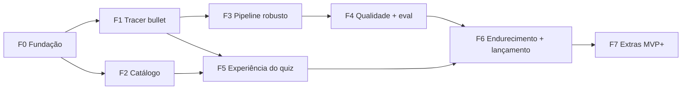

# 10. Plano de execução

**Esforço:** P ≤ 1 dia · M = 2–4 dias · G = 5–10 dias (dias de trabalho focado). **Total estimado:** 30–45 dias focados; com assistente de código, a faixa baixa é realista. Cada tarefa abaixo cabe em até meio dia e vira um commit (ou PR pequeno).

## 10.1 Dependências e marcos

| Marco | Quando | O que prova |
|---|---|---|
| M1 | fim da F1 | Um quiz real ponta a ponta, no celular, para um episódio fixo |
| M2 | fim da F3 | Qualquer episódio com legenda EN gera quiz ou falha com o motivo certo |
| M3 | fim da F4 | Qualidade medida; modelo padrão decidido (A1) |
| M4 | fim da F6 | **MVP em produção** |
| M5 | fim da F7 | Extras MVP+ (upload, pré-geração, relatos, painel) |

F2 pode correr em paralelo à F1; a F5 pode começar com o quiz sintético do seed logo após a F1.

---

## F0 — Fundação · M
**Objetivo:** repositório, ferramentas, CI e deploy vazio funcionando, com contas e chaves prontas.
**Depende de:** nada.

> **Adaptada ao Next.js em 23/10/2026 (ADR-014).** Os itens marcados foram feitos na stack nova; o texto original fica como referência.

- [x] Criar o repositório (privado) e copiar `docs/`; criar `CLAUDE.md` com as regras de §15.0 e o mapa dos documentos. *(regras adaptadas ao Next.js)*
- [x] Vite + React + TypeScript (`strict`), Tailwind CSS v4 com `@tailwindcss/vite`, Biome, aliases `@/`, `@shared/`, `@server/`. *(Next.js 16 + React 19, Tailwind v4, ESLint no lugar do Biome, mesmos aliases)*
- [x] Estrutura de pastas de §9.14 com arquivos placeholder. *(estrutura do App Router, ver tabela do ADR-014)*
- [x] `server/lib/env.ts` com Zod e `.env.example` completo (§13.2); a aplicação falha ao subir se faltar variável obrigatória. *(`src/server/env.ts`, checado em `src/instrumentation.ts`)*
- [x] Hono com `GET /api/health`; `api/[[...route]].ts`; `scripts/dev-server.ts`; proxy `/api` no Vite; `pnpm dev` sobe os dois. *(route handler `src/app/api/health/route.ts`; um único `pnpm dev`)*
- [x] Drizzle configurado (Neon em dev/prod, PGlite em teste) com uma migração inicial vazia. *(migração inicial gerada do schema existente; o PGlite aplica as mesmas migrações)*
- [x] Vitest (cobertura) e Playwright instalados, com um teste trivial cada. *(Playwright: Pixel 7/Chromium e iPhone 14/WebKit)*
- [x] `ci.yml` (§13.7): lint, typecheck, testes, build. *(também E2E e check-bundle)*
- [ ] Projeto na Vercel ligado ao GitHub (preview por PR, produção na `main`); Neon via Marketplace da Vercel.
- [ ] Contas e chaves: TMDB, OpenSubtitles (consumer), Anthropic (com limite de gasto mensal); variáveis cadastradas na Vercel (§13.3).

**Critérios de aceite:** `pnpm check` verde no CI; o preview abre a página "Segunda Tela" e `/api/health` responde 200; `grep` no `dist/` não encontra nenhuma chave. *(No Next.js, o `check-bundle` roda dentro de `pnpm build` e varre `.next/static` e as respostas pré-renderizadas.)*

## F1 — Tracer bullet (série fixa) · G
**Objetivo:** um quiz real gerado ponta a ponta para **um episódio fixo** (sugestão: Victorious S01E01), visível no celular, usando a arquitetura final em versão mínima.
**Depende de:** F0.

- [ ] `scripts/os-probe.ts`: descobre o `TRACER_SERIES_ID` via `/search/tv`, roda E1–E5 (§4.2.4) e grava fixtures só de metadados (checklist §4.2.12).
- [ ] Cliente TMDB mínimo: episódio en-US com `external_ids`.
- [ ] Cliente OpenSubtitles mínimo: login (token em memória), busca pela estratégia 1, `POST /download`, baixar o arquivo.
- [ ] Parser mínimo com testes: D01/D03/D04/D06, SRT, R01, R02, R06, R07, R10, M01, M07, S01–S05 (casos ENC-01, ENC-05, SRT-01, SRT-02, CLN-01, CLN-05, CLN-09, SEG-01).
- [ ] Prompt v0 (§8.3–§8.4) + schema (§8.6) + chamada por bloco com concorrência 4; validação só de schema e de `EVIDENCE_LINES_INVALID`.
- [ ] Tabelas `episodes`, `quizzes`, `generation_jobs` + migração.
- [ ] `POST …/quiz` aceitando **apenas** o episódio fixo (`TRACER_ONLY=true`), job + `waitUntil` + `GET /api/jobs/:id`; `GET …/quiz`.
- [ ] Página `/tracer`: botão "Gerar", progresso por polling e lista de perguntas com "mostrar resposta".
- [ ] Registrar `usage` e custo no quiz.
- [ ] Teste de logger: falha se receber string de mais de 3 palavras vinda do pipeline (§7.13).

**Critérios de aceite:** no preview, gerar o episódio fixo produz ≥ 3 blocos e ≥ 20 perguntas válidas em ≤ 120 s; reabrir usa o cache (sem chamar OpenSubtitles nem LLM, confirmado no log); nenhuma tabela ou log contém texto de legenda; custo do job registrado.

## F2 — Catálogo · M
**Objetivo:** busca, série, temporadas e episódios com dados da TMDB, cache na CDN e status do quiz.
**Depende de:** F0.

- [ ] Cliente TMDB completo (busca, série, temporada pt-BR + fallback en-US, configuração) com mappers e testes (§4.1).
- [ ] Rotas `/api/config`, `/api/series/search`, `/api/series/:id`, `/api/series/:id/seasons/:n` com `Cache-Control` exato (§6.2) + testes de contrato.
- [ ] Rota `quiz-status` (consulta §5.4) + testes com PGlite.
- [ ] Front: `Providers`, `AppShell`, `BottomNav`, `TmdbImage` (srcset), `queryKeys`, cliente `api.ts` com tratamento de `Problem`.
- [ ] `HomePage`: `SearchBox` (debounce 300 ms), resultados, "Carregar mais", buscas recentes.
- [ ] `SeriesPage`: cabeçalho, `SeasonPicker`, `EpisodeList`, `QuizStatusBadge`, `NumberingNotice`, `SpoilerReveal`.
- [ ] `EpisodePage` com "Abrir quiz" ou "Gerar quiz" (geração ainda pela rota do tracer).
- [ ] Handlers MSW para testes de componentes.

**Critérios de aceite:** US-01 a US-03 atendidas; testes de contrato do catálogo verdes; Lighthouse mobile ≥ 90 (desempenho) na Início.

## F3 — Pipeline de legendas robusto · G
**Objetivo:** qualquer episódio com legenda EN funciona, ou falha com o código certo, sem desperdiçar cota.
**Depende de:** F1.

- [ ] Parser completo do item 7 (D01–D07, F01–F05, SRT tolerante, VTT, N01–N04, R01–R20, falantes, M01–M07, S01–S07, Q01–Q07) com **todos** os casos de §7.14.
- [ ] Golden files sintéticos (§7.15), testes de propriedade (fast-check) e de desempenho.
- [ ] Resolução de IDs (§4.2.5): cadeia de 5 estratégias, `titleMatch` (SIM-01..04), `numbering_mismatch`.
- [ ] Filtros e pontuação (§4.2.6–4.2.7) com SEL-01..10.
- [ ] Download (§4.2.8): gzip, limite de 2 MB, **allowlist de host do link** (item 12), registro em `subtitle_selections`, limite de 2 downloads por episódio/24 h.
- [ ] Sessão da OpenSubtitles cifrada em `provider_state`, relogin em 401; estado da cota e falha rápida.
- [ ] `withRetry` + mapeamento de erros (§4.2.9, §4.1.5) com testes por situação.
- [ ] Estágios, progresso e `heartbeat` do job; deadline de 240 s; `JOB_STALLED` na leitura.
- [ ] `episodes.subtitle_status` e janela de 24 h para `no_subtitle`.
- [ ] Rodada manual em 10 episódios variados (inclua um caso de numeração divergente, como o S1E4 de Victorious).

**Critérios de aceite:** 100% dos casos do item 7 passando; cobertura do parser ≥ 95%; na rodada manual, ≥ 9 de 10 episódios geram quiz ou falham com o código correto; média ≤ 1,2 downloads por quiz pronto.

## F4 — Qualidade do quiz e avaliação · G
**Objetivo:** prompt final, validações completas e qualidade **medida**; decidir o modelo padrão.
**Depende de:** F3.

- [ ] Prompt v1 e plano de slots (§8.2–§8.5) com `PROMPT_VERSION`.
- [ ] `gen:schema` + snapshot + "lint" do schema (§8.6).
- [ ] Validadores de §8.7, um teste por código (positivo e negativo).
- [ ] Verificação de evidência (exata e aproximada, com troca pela citação exata).
- [ ] Fluxo de reparo (§8.5) e política de retry; `QUALITY_CHECK_FAILED`.
- [ ] Pós-processamento P01–P07 (embaralhamento determinístico, ordem, orçamento de citação, deduplicação) e `QuizDocument.parse`.
- [ ] Harness `pnpm eval` (item 11) com os 5 episódios de referência, cache local e matriz de configurações.
- [ ] Planilha/JSON da rubrica; juiz automático opcional calibrado com a revisão humana.
- [ ] Rodar a matriz (Sonnet `medium`, Sonnet `low`, Haiku `medium`) e registrar a decisão A1 no ADR-007.

**Critérios de aceite:** relatório de eval commitado (só agregados); na configuração escolhida, ≥ 90% de perguntas aceitáveis e 0 erros críticos; custo e latência dentro de NFR-03/NFR-04.

## F5 — Experiência do quiz · G
**Objetivo:** responder bloco a bloco sem spoiler, com feedback, placar, histórico e configurações.
**Depende de:** F1 e F2 (pode usar o quiz sintético do seed antes da F4).

- [ ] `QuizLayout` + `QuizPage` com `SegmentGate`, `QuestionCard`, `OptionList` (radiogroup), pular e confirmar.
- [ ] `FeedbackPanel`: banner, explicação EN/PT, evidência após a resposta.
- [ ] `SegmentSummary` com desbloqueio do próximo bloco e "Liberar tudo".
- [ ] `selectQuestions` (nível, vizinhos, fallback) e `scoring` como funções puras com testes.
- [ ] Stores locais (§5.6) com versão, `migrate` e backup de dados corrompidos; testes de migração.
- [ ] `ResultPage`, `HistoryPage` (filtro, retomar), `SettingsPage`.
- [ ] Modo sem spoiler completo (§9.9).
- [ ] Tema com script anti-flash (§9.10) e `useWakeLock`.
- [ ] Acessibilidade de §9.11 (foco, `aria-live`, `lang="en"`).
- [ ] E2E do fluxo de quiz (WebKit e Chromium) com axe.

**Critérios de aceite:** US-09 a US-15 atendidas; axe sem violações sérias/críticas; E2E verde nos dois motores; retomar uma tentativa após fechar a aba funciona.

## F6 — Endurecimento e lançamento · M
**Objetivo:** segurança, limites, conformidade e produção.
**Depende de:** F4 e F5.

- [ ] Código de acesso: `POST /api/access/verify`, `AccessCodeDialog`, armazenamento local.
- [ ] Middleware de rate limit com os buckets de ADR-006; tetos diários de gerações e US$; limite de gasto no Console da Anthropic.
- [ ] Checagem de `Origin`; cabeçalhos de segurança e CSP (item 12) no `vercel.json`.
- [ ] Logger estruturado com redação de cabeçalhos sensíveis.
- [ ] Autenticação de admin; `POST /api/admin/maintenance` (renovação TMDB e expurgos) e cron semanal no GitHub Actions.
- [ ] Página Sobre: logo aprovado da TMDB + aviso exato, crédito OpenSubtitles, aviso de IA, privacidade, contato para remoção.
- [ ] Mensagens de erro do catálogo §6.5 ligadas na UI.
- [ ] Suíte E2E completa (item 11) e Lighthouse CI.
- [ ] Variáveis de produção, deploy, smoke test e runbook (§13.10).

**Critérios de aceite:** todos os testes de §6.8 verdes; checklist de §12.6 completo; produção no ar; manutenção agendada executada com sucesso uma vez.

## F7 — Extras MVP+ · M
**Objetivo:** recursos opcionais que reduzem atrito e dão visibilidade de uso.
**Depende de:** F6.

- [ ] Upload manual (`POST …/quiz/upload` + UI + testes US-07).
- [ ] Relatos de pergunta (`POST …/reports` + `ReportButton`).
- [ ] Pré-geração: `pregen_queue`, `POST /api/admin/pregen`, `POST /api/admin/pregen/run`, laço no GitHub Actions, reserva interativa.
- [ ] `GET /api/admin/stats`.
- [ ] Exportar/importar histórico em JSON.

**Critérios de aceite:** US-07, US-17 e US-18 atendidas; teste de pré-geração com cota simulada prova que a reserva nunca é usada.

---

## 10.2 Riscos e mitigações

| # | Risco | Prob. | Impacto | Mitigação | Gatilho para agir |
|---|---|---|---|---|---|
| R1 | Cota da OpenSubtitles insuficiente | Média | Alto | Cache permanente, banco multinível, 2 downloads/episódio, reserva, upload manual | Cota esgotada > 2×/semana → VIP |
| R2 | Legenda do episódio errado (numeração) | Média | Alto | Validação de título, Q03 (duração), estratégias por ID, relato de problema | `numbering_mismatch` > 10% dos jobs |
| R3 | Termos da OpenSubtitles contra uso com LLM | Baixa | Alto | Perguntar ao suporte antes do lançamento; interface de provedor; upload manual | Resposta negativa → desligar busca automática |
| R4 | Qualidade fraca das perguntas | Média | Alto | Evidência verificada, validadores, eval, troca de modelo/esforço | Aceitáveis < 90% no eval ou relatos > 2% |
| R5 | Custo de LLM fora do previsto | Baixa | Médio | Teto diário, limite no Console, métricas de tokens | Gasto > 70% do teto 3 dias seguidos |
| R6 | Limite de 300 s da função | Baixa | Médio | Blocos em paralelo, deadline de 240 s, Hono portável | p95 do job > 180 s → Fly.io ou Cloudflare |
| R7 | Termos da TMDB (não comercial, cláusula de IA, 6 meses) | Baixa | Médio | Nenhum dado da TMDB na LLM; atribuição; renovação < 150 dias | Mudança nos termos |
| R8 | Reclamação de direitos autorais | Baixa | Médio | Sem armazenamento de legenda; citações curtas; retirada de quiz; contato | Pedido recebido → retirar em ≤ 72 h |
| R9 | Tempos da legenda diferentes do streaming | Alta | Baixo | "≈", blocos de 5 min, desbloqueio manual | Reclamação recorrente → ajuste de deslocamento [PÓS] |
| R10 | Perda do histórico local | Média | Baixo | Exportar/importar; formato pronto para sincronizar | — |
| R11 | Injeção de prompt via legenda | Baixa | Baixo | R15/R16, dados entre tags, sem ferramentas, validação | Flag `injectionDropped` > 0 com frequência |
| R12 | Escopo crescendo (dev solo) | Alta | Médio | Tracer bullet, MVP fechado, backlog priorizado | Fase passa 50% da estimativa → cortar escopo |
| R13 | Limites ou cold start do Neon | Baixa | Baixo | Scale-to-zero aceito; alerta a 70% do espaço | Espaço > 70% ou CU-horas no limite |
| R14 | Mudança de API/modelo da LLM | Média | Médio | ID de modelo fixo por variável; abstração; testes com o provedor falso | Aviso de descontinuação |
